# 可选择 ASR、LLM、TTS 的实时语音助手实施方案

> 历史归档（2026-11-12 整理）：保留当时的实现、证据与待验状态。正文中的“当前”“下一步”、旧构建目录和命令均属于该批记录；日常操作请查[操作指南](../operations.md)，最新状态请查[当前进度](../realtime_voice_progress.md)，返回[文档索引](../README.md)。归档不改变未验收事项。

当前执行位置（2026-11-12）：用户认可 D2 能量持续性修正后的基本效果，并确认扬声器恢复供电后也正常。当前先处理正常自动识别对短促动静敏感的问题，已增加独立 160 ms／AC RMS 80 起音持续性保护，保留 400 ms 预录；主机回归通过，新固件目标编译和实机效果待用户验证，见[正常监听起音修正](p4/p4_idle_onset_filter_20261112.md)。继续使用根 `sdkconfig`／`build/barge-in-test`，本批需要重建／烧录；之后进入 P5「集成与选择体验」。已确认 D2 项沿用，不要求切换旧诊断固件或重复 D1／已跳过的 B；完整声学、标定和长时资源继续保留。

更新：2026-11-11。**第八批AEC固件已实际运行，基本功能本轮正常，用户确认“一切正常”。** 附件`78018aa0-d596-406b-ac02-151ee0403406`启动ELF前缀`17284ff14`与第八批`17284ff146`匹配；日志记录至120.034秒，未见E级错误、看门狗、`first_failure`或AEC失效，turn 1～4均正常结束上行。AEC／参考健康、供给调度和资源已有本轮样本，91.351秒停播栅栏后turn 4仍成功；日志未标明完整`c/a`按键顺序，不能据此勾选全部取消和长播专项。详细问题、修复过程与本轮证据见[AEC问题复盘](p4/p43c_aec_issue_retrospective.md)及[第八批修复](p4/p43c_playback_stutter_fix.md)，硬件记录为`build/p43c_eighth_repair_hardware_observation.json`。C基础稳定反馈已登记，远端／近端／双讲等受控声学效果和标定仍未验收，`calibrated=0`，D关闭，B跳过项保留。

本文第1–10节主要保留制定方案时的目标、历史代码基线和接口草案；其中“尚未接入”等历史描述不代表当前完成度，后续P4.2实施／实机说明已明确标注。实际启动命令和当前能力以[实施进度](realtime_voice_progress_20261112.md)及[服务端说明](../../server/README.md)为准。

## 1. 已确定的路线

目标是让 ESP32-S3 从采集语音到播放回答形成实时链路，同时分别选择语音识别（ASR）、回答模型（LLM）和语音合成（TTS）。采用三个独立服务串接的架构：

```mermaid
flowchart LR
    MIC[ESP32 麦克风] --> AFE[PCM转换 / AFE / VAD]
    AFE --> ENC[ESP32 Opus 编码]
    ENC --> UP[设备 WebSocket 上行]
    UP --> DEC[Python 解码为 PCM]
    DEC --> ASR[可选 ASR]
    ASR -->|确认的一轮问题| LLM[可选 LLM]
    LLM -->|文本增量| SEG[稳定文本分句]
    SEG --> TTS[可选 TTS]
    TTS --> NORM[Python 音频规范化 / Opus 编码]
    NORM --> DOWN[WebSocket 下行]
    DOWN --> PLAY[ESP32 Opus 解码]
    PLAY --> SPK[ESP32 PCM 流式播放]
    SPK -. 实际播放参考 .-> AFE
```



这里的“端到端实时”指整条设备交互链路；具体采用可替换的 ASR → LLM → TTS 流水线。之前讨论的 Seeduplex 单模型实时对话属于另一种架构，不放进 ASR 选项冒充识别器。以后若接入，应增加独立的 conversation backend。

首版目标提供至少 2 种 ASR、2 种 LLM 接入配置、2 种 TTS；三层可以交叉组合。模型和音色由服务端配置，设备只连接统一的本地服务，切换云模型无需重新烧录固件。

默认推荐组合：**豆包流式 ASR 2.0 → DeepSeek 流式 LLM → 火山双向流式 TTS**。这是实施后的推荐配置，不在本轮更改当前启动行为。

设备与本地Python服务之间首版默认采用**Opus、20 ms帧**，上行16 kHz、下行24 kHz，均为单声道；PCM16保留作显式协商的调试和兼容回退。音频处理内部仍使用PCM，云服务格式由适配器转换。本约定替代早期“先PCM传输、以后再加入Opus”的规划。

## 2. 制定方案时的历史基础与需要补齐的内容

| 环节 | 当前代码 | 本次规划的改变 |
| --- | --- | --- |
| 设备应用 | 初始化屏幕、启动音和 Wi-Fi，循环刷新 UI | 接入采集、处理、双向网络和播放任务 |
| 麦克风 | 已有 ICS-43434 驱动，应用尚未调用；返回左对齐的 24 位样本，容器为 int32 | PCM16 转换、音量统计、连续采集、AFE/VAD |
| 扬声器 | 已有 MAX98357A 驱动，支持 24 kHz；启动音后会释放 | 持续播放服务、限长队列、取消、实际播放参考 |
| ASR | Qwen 整段 PCM → WAV → HTTPS 识别 | 保留整段适配器，新增豆包流式适配器 |
| LLM | DeepSeek，stream=false | 流式生成和可选择的模型配置 |
| TTS | 尚未实现 | 火山和 CosyVoice 两种流式适配器 |
| 设备协议 | 现有服务提供 /ping、/audio，固件尚未接入录音上传 | 增加版本化双向 WebSocket、双向Opus编解码与PCM回退 |
| 对话状态 | 单个互斥状态枚举 | 会话、采集、回复、播放分别表示 |

历史代码依据：`main/app/voice_assistant_app.cpp`、`main/app/voice_assistant_status.hpp`、`main/audio/ics43434_microphone.hpp`、`main/audio/max98357a_audio.cpp`、`server/audio_test_server.py`。制定本方案时尚无ESP-SR、设备WebSocket、Opus及模型分区；这些组件现已接入，当前分区和验证结果见P4部署记录。

当前 Qwen 路径必须标为“整句识别兼容模式”。设备到服务器使用 WebSocket，并不会改变其收齐一句才识别的能力。保留该选项，但界面和能力查询必须说明它没有真实的识别中间结果。

## 3. 服务商、接口和模型分别管理

### 3.1 首版选项

| 层 | 服务商 / 适配器 | 模型或资源配置 | 行为 |
| --- | --- | --- | --- |
| ASR | 阿里云 `qwen_batch` | 保留 `qwen-audio-3.1-asr-flash` 及现有 Workspace 接入 | 缓存一轮发言后整段识别；无 partial |
| ASR | 火山 `doubao_streaming` | `model_name=bigmodel`，2.0 资源 ID 单独配置 | 实时上传音频，接收中间文本和确定结果 |
| LLM | DeepSeek / `chat_completions` | 保留当前 `deepseek-flash`；允许登记其他已验证模型 | SSE 文本流 |
| LLM | 阿里云 Qwen / `chat_completions` | 按账号可用模型和地域登记 model ID | SSE 文本流；接入地址单独配置 |
| TTS | 火山 `volcengine_bidirectional` | 首选 TTS 2.0；resource ID、音色分别配置 | 流式文本输入、流式音频输出 |
| TTS | 阿里云 `cosyvoice_bidirectional` | 按开通情况登记 CosyVoice model ID 和音色 | 流式文本输入、流式音频输出 |

模型名称不是适配器。相同协议下可以添加多份模型配置，协议不同则需要新适配器。不能承诺填写任意 model ID 就可以调用；地区、鉴权、参数、输出格式、思考模式及音色权限都要验证。

账号已开通豆包 ASR 2.0，不代表已开通火山 TTS、实时对话或其他模型。实现前仅核对所选服务的账号资源，不把无关服务的缺失当作启动错误。

### 3.2 统一接口与能力

| 接口 | 主要操作 / 输出 | 必须声明的能力 |
| --- | --- | --- |
| `AsrProvider` | start、feed_audio、end_utterance、cancel、close；输出 partial、segment_final、utterance_final、error | 流式输入、部分结果、终点机制、格式、上游分帧/保活要求 |
| `LlmProvider` | generate(messages) 的异步增量迭代器、cancel、close | 文本流、支持的参数、上下文限制、思考与回答的区别 |
| `TtsProvider` | start、append_text、finish、cancel、close；输出音频块及格式 | 流式文本输入、流式音频输出、音色/模型兼容、音频格式 |

接口归一的是业务事件，不强行抹平厂商差异：

- `qwen_batch` 在 `end_utterance` 后请求整段识别；用异步 HTTP 或可控工作任务避免阻塞事件循环。
- 豆包 ASR 适配器接收服务端解码后的PCM，处理厂商二进制帧、协议压缩、序列号、确定文本和结束包，按文档节奏合并/拆分音频。设备20 ms Opus帧先经过统一解码层，不直接构造火山协议，也不把厂商协议的压缩方式等同于Opus。
- 区分“识别片段确定”和“本轮用户说完”。一个 `segment_final` 不一定结束整个用户回合；协调器只提交一次 `utterance_final`。
- LLM 只把可播报的回答文本送往 TTS，思考字段、工具参数和协议元数据不得混入播报。
- 非流式模型如果以后加入，必须显示为兼容能力，不能因为接口一致就标成全流式。

启动/选择时计算实际能力。`require_streaming_asr=true` 的配置若选择 Qwen batch，应在开始会话前拒绝并说明原因；兼容配置可以正常选用它。

## 4. 配置方式与用户选择

### 4.1 配置文件职责

- `server/config/voice_config.json`：非密钥业务配置，包含模型登记、音色、超时和命名组合；实现时提供 `voice_config.example.json`。
- `server/config/server_secrets.json`：延续当前本地密钥文件；也可使用环境变量。真实内容不写入文档、固件或可查询接口。
- `server/core/config.py`：schema 校验、旧变量兼容和不可变的配置快照。

密钥解析保持“环境变量优先于本地密钥文件”。新增 ASR/LLM/TTS 凭证按服务分别引用，例如 `VOLCENGINE_ASR_API_KEY`、`VOLCENGINE_TTS_API_KEY`、`DASHSCOPE_API_KEY`、`DEEPSEEK_API_KEY`；现有 Workspace ID 和 model 环境变量继续兼容旧入口。

业务选项优先级：明确的启动/会话选择 → 命名 profile → 文件默认值。运行中修改文件不静默改变当前回合；必须经过显式校验/加载。未选择服务的密钥可以缺省。

以下是**未来配置格式草案**，本轮不创建实际运行配置；尖括号值必须在实施联调时替换。`credential_ref` 仅为变量名：

```json
{
  "schema_version": 1,
  "active_profile": "realtime_default",
  "transport": {
    "frame_duration_ms": 20,
    "channels": 1,
    "vbr": true,
    "dtx": false,
    "allow_pcm_fallback": true,
    "fallback_codec": "pcm_s16le",
    "uplink": {
      "codec": "opus",
      "sample_rate_hz": 16000,
      "bitrate_bps": 24000
    },
    "downlink": {
      "codec": "opus",
      "sample_rate_hz": 24000,
      "bitrate_bps": 32000
    }
  },
  "asr": {
    "doubao_2": {
      "adapter": "doubao_streaming",
      "model": "bigmodel",
      "resource_id": "volc.seedasr.sauc.duration",
      "credential_ref": "VOLCENGINE_ASR_API_KEY"
    },
    "qwen_existing": {
      "adapter": "qwen_batch",
      "model": "qwen-audio-3.1-asr-flash",
      "workspace_ref": "DASHSCOPE_WORKSPACE_ID",
      "credential_ref": "DASHSCOPE_API_KEY"
    }
  },
  "llm": {
    "deepseek_default": {
      "adapter": "chat_completions",
      "base_url": "https://api.deepseek.com",
      "model": "deepseek-flash",
      "credential_ref": "DEEPSEEK_API_KEY"
    },
    "qwen_default": {
      "adapter": "chat_completions",
      "base_url": "<与实际地域和 Workspace 匹配的兼容地址>",
      "model": "<已验证的 Qwen 模型 ID>",
      "credential_ref": "DASHSCOPE_API_KEY"
    }
  },
  "tts": {
    "volc_default": {
      "adapter": "volcengine_bidirectional",
      "resource_id": "seed-tts-2.0",
      "voice": "<该资源支持的音色 ID>",
      "credential_ref": "VOLCENGINE_TTS_API_KEY"
    },
    "cosyvoice_default": {
      "adapter": "cosyvoice_bidirectional",
      "endpoint": "<与实际地域和 Workspace 匹配的 WebSocket 地址>",
      "model": "<已验证的 CosyVoice 模型 ID>",
      "voice": "<与模型匹配的音色 ID>",
      "credential_ref": "DASHSCOPE_API_KEY"
    }
  },
  "profiles": {
    "realtime_default": {
      "asr": "doubao_2", "llm": "deepseek_default", "tts": "volc_default",
      "require_streaming_asr": true
    },
    "qwen_compatible": {
      "asr": "qwen_existing", "llm": "deepseek_default", "tts": "cosyvoice_default",
      "require_streaming_asr": false
    }
  }
}
```

2.0 ASR 按小时资源 ID 为 `volc.seedasr.sauc.duration`，按并发为 `volc.seedasr.sauc.concurrent`；选择以实际开通资源为准。火山 ASR/TTS 的资源 ID、鉴权和配额分别处理。

`transport`独立于三层模型选择。24/32 kbps为上/下行的初始目标码率，均可调，并非已测得的最佳值；最终参数由识别准确率、音质、设备负载和带宽实测决定。Opus采用VBR，包长可变；首版关闭DTX，连续静音仍维持音频时间线。PCM回退需在握手/新流建立时确认，编码相关设置在PCM模式不适用，不允许同一个流中途静默切换格式。

### 4.2 首版就能如何选择

实施后必须同时支持配置文件和命令行，而非只在代码里改常量。计划的命令形态为：

```powershell
# 以下命令是待实现接口，当前入口还不支持。
python server/voice_server.py --list-options
python server/voice_server.py --profile realtime_default
python server/voice_server.py --profile qwen_compatible
python server/voice_server.py --asr doubao_2 --llm qwen_default --tts cosyvoice_default
```

三项覆盖参数可独立使用；未覆盖项继承 profile。设备收到脱敏后的当前组合名称和实际能力，用于显示。

配置快照绑定一个会话。默认更换 profile 开启新会话，清空对话上下文；如需立即切换，先取消当前回复并确认停播，再关闭上游会话、校验新组合并创建新的 `session_id/session_epoch`。切换失败保留可选择的原配置，不在半个回合中自动换服务商。后续图形设置页复用这套选择和校验逻辑，首版无需为此增加网页框架。

## 5. 服务端文件组织

以下为目标目录，按实施阶段逐步添加，避免先创建无用空壳：

```text
server/
├── voice_server.py                     # 新服务入口、参数解析和启动
├── audio_test_server.py                # 现有入口，迁移时保留兼容契约
├── start_voice_server.ps1              # 启动脚本，支持选择 profile
├── requirements.txt
├── README.md
├── config/
│   ├── voice_config.example.json       # 非密钥模型/组合示例
│   ├── voice_config.json               # 本地实际选择
│   ├── server_secrets.example.json
│   └── server_secrets.json             # 本地密钥，继续忽略
├── core/
│   ├── config.py                       # 配置解析、校验与快照
│   ├── events.py                       # 事件、音频描述和能力定义
│   ├── provider_registry.py            # 已实现适配器注册与创建
│   ├── session.py                      # 每设备会话、历史和回合编号
│   ├── pipeline.py                     # ASR→LLM→TTS、任务取消
│   └── text_segmenter.py               # 稳定文本分段和播报过滤
├── providers/
│   ├── asr/{base,qwen_batch,doubao_streaming}.py
│   ├── llm/{base,chat_completions}.py
│   └── tts/{base,volcengine,cosyvoice}.py
├── transport/
│   ├── http_routes.py                  # /ping、/audio 旧契约
│   └── voice_websocket.py              # 统一实时协议与连接生命周期
├── audio/
│   ├── formats.py                      # PCM/Opus格式描述和载荷校验
│   ├── opus_codec.py                   # 按流维护Opus解码/编码状态
│   └── resampler.py                    # 必要时有状态重采样
├── data/                               # 有限、可关闭的调试数据
└── tests/                              # 原测试和按责任拆分的新测试
```

`llm/chat_completions.py` 可以服务于 DeepSeek 和 Qwen，但各自模型、地址、凭证和参数策略独立。ASR 与 TTS 的厂商协议差异保留在对应文件里。

首选 `aiohttp` 统一本地 HTTP/WS、上游 HTTP/SSE/WS，复用连接池及异步取消；服务目前只用标准库，实施时需更新并锁定验证过的依赖。若需要重采样，再选择支持连续状态的实现，不通过逐包独立重采样制造边界噪声。首版保持单 Python 服务，无需微服务或动态安装插件。

服务端Opus基于libopus及验证过的Python绑定实现，确认Windows下原生库的架构、加载路径、版本与安装方式，并写入启动检查和依赖说明。编码/解码器按流保存状态，不能为每个网络包重建；CPU工作放在有界的处理任务中，不阻塞异步网络循环。适配器对云端仍使用经过验证的PCM/WAV等格式，双向Opus传输不要求云服务直接支持原始Opus包。

旧 `GET /ping` 和 `POST /audio` 的输入、响应及默认 Qwen→DeepSeek 行为保持兼容：后者仍接收完整 PCM16，返回两行文字，不因新增 TTS 改为音频响应。新运行入口复用重构后的适配器；旧 Python 测试接口在迁移时要同步维护，不能留下两份长期分叉的识别实现。

## 6. 固件文件组织与任务边界

```text
main/
├── main.cpp                            # 仅入口
├── app/
│   ├── voice_assistant_app.cpp/.hpp     # 初始化、模块装配
│   ├── conversation_controller.cpp/.hpp# 回合、打断和连接协调
│   └── voice_assistant_status.hpp       # 各维度状态及UI快照
├── audio/
│   ├── ics43434_microphone.cpp/.hpp     # 现有麦克风驱动
│   ├── max98357a_audio.cpp/.hpp         # 现有扬声器驱动
│   ├── audio_service.cpp/.hpp          # 音频任务与生命周期
│   ├── audio_processor.cpp/.hpp        # PCM转换、ESP-SR AFE/VAD/AEC
│   ├── sr_model_manager.cpp/.hpp       # 本地ESP-SR模型加载、校验及生命周期
│   ├── opus_codec.cpp/.hpp             # Opus编码/解码、缓冲和流状态
│   ├── audio_playback.cpp/.hpp         # 队列、时序、取消和播放参考
│   └── audio_frame.hpp                # 统一格式和帧元数据
├── network/
│   ├── wifi_station.cpp/.hpp           # 现有Wi-Fi管理
│   ├── voice_client.cpp/.hpp           # WS连接、重连与收发
│   └── voice_protocol.cpp/.hpp         # JSON事件与二进制帧
├── display/                            # 沿用驱动和UI，只消费状态
├── fonts/
├── CMakeLists.txt
└── idf_component.yml
```

分别运行采集、AFE feed/fetch、Opus编解码、网络收发和播放任务；最终任务数量与优先级按 SDK 要求和测量决定。回调只投递事件，禁止在音频任务、网络回调或 UI 渲染里做阻塞云请求。UI 继续通过线程安全快照更新。

保持当前 I2S 和 GPIO：麦克风 I2S1（4/5/6），扬声器 I2S0（15/16/17，SD=8）。GPIO7 的按钮接法尚需核对；手动录音/打断测试不能默认占用未确认引脚。

新增 ESP-SR、Opus编解码和设备 WebSocket 组件时更新 `idf_component.yml`、CMake、sdkconfig；基于当前 IDF 6.1 检查兼容版本。小智的 ESP-SR 2.4.7、`esp_audio_codec`约2.5.0及Opus接口可作参考，不直接假定可原样移植；核对所选组件的Opus编码/解码、20 ms和16/24 kHz支持。选定VAD模型、AEC配置及模型打包方式后再计算模型分区、应用分区和 RAM，不能按剩余 16 MB Flash 随意填写偏移。每个新增源文件需在编译信息中确认。

状态拆为至少四个维度：`session`（连接/重连）、`capture`（监听/讲话）、`response`（识别/生成/取消）、`playback`（缓存/播放/停止）。这样可以同时表示“正在播放”与“正在监听”。现有 320 字节屏幕文本缓冲和 120/96 字节 HTTP 截断仅属于旧显示/旧接口约束，不得限制新路径的完整识别、上下文或 TTS 内容。

## 7. 音频、VAD 与回声消除

### 7.1 首版Opus传输与PCM处理格式

| 方向 | 设备与Python之间默认传输 | 编解码前后内部PCM / 调试回退 |
| --- | --- | --- |
| 麦克风上行 | 原始Opus packet，16 kHz、单声道、20 ms/包 | PCM16LE；每20 ms为320样本、640字节 |
| 扬声器下行 | 原始Opus packet，24 kHz、单声道、20 ms/包 | PCM16LE；每20 ms为480样本、960字节 |
| AFE 输入 | 不使用网络编码，始终处理PCM | 16 kHz，按API组织mic/reference；feed/fetch块长读取SDK |

每个设备WS二进制消息携带一个Opus packet；PCM字节数只用于内部缓冲与PCM回退，不能用640/960字节固定长度校验变长Opus载荷。20 ms帧与编码选择独立，小智的60 ms不是Opus的固定要求。

初始目标码率为上行24 kbps、下行32 kbps，编码载荷平均约3/4 KB每秒；VBR的实际包长与流量需测量。相比之下，PCM上/下行分别约32/48 KB每秒。协议开销另计：32字节业务头在每方向每秒50包时约1.6 KB每秒，还需叠加WebSocket/TCP/TLS开销，不能把载荷码率直接当成网络总带宽。

上行流程：麦克风int32 → PCM16 → AFE/VAD/AEC → Opus编码 → WS → Python解码PCM → 所选ASR的格式适配。下行流程：所选TTS → Python规范化为24 kHz单声道PCM16 → Opus编码 → WS → ESP32解码PCM → 播放。TTS厂商写作`pcm`不足以证明位深/端序相同，适配器必须确认并规范化，容器头不能当PCM播放。

原始Opus packet与Ogg/WebM容器中的Opus不同。首版不假定豆包/Qwen可直接接收小智式原始包，也不假定云TTS的Ogg Opus可以逐包直通设备；统一在Python层解码/规范化/重新编码，保留厂商自由选择。之后若优化直通，需另行验证封装、采样率和流生命周期。

Opus是有损编码，首版需用相同录音对比PCM与Opus识别结果，覆盖中文、弱音及背景噪声。低复杂度起步并测CPU、内存和播放连续性；20 ms减少攒帧等待，但增加包数和编解码工作，不承诺固定的总延迟收益。WebSocket基于TCP，丢包可能导致重传等待，Opus不能替代有界队列、超时和重连处理。

编解码器按`session_epoch + stream_id`保持独立状态；上/下行分别管理。取消仅废弃被取消回复的下行流状态及尾包；正常换轮不重置持续上行编解码器。重连或更换编码时清理并重建受影响的流。尾帧不足20 ms时补零，输入长度恰好为20 ms整数倍时也必须处理编码前瞻的排空；使用流开始的`pre_skip_samples`和结束的`end_sample_offset`等元数据处理有效首尾裁剪，测试首字和尾音完整。时间基准和字段语义在协议阶段冻结，不把补零或编码延迟算作用户实际语音；PCM回退也保留相同的有效音频时间线。

### 7.2 设备本地处理

参考小智，在 ESP32-S3 使用 ESP-SR AFE 承担 VAD，并为 AEC 留出实际播放参考。设备本地完成的是采集、格式转换、可选降噪/回声消除、讲话判断和缓存；通用语音转文字留在所选云 ASR。

2026-11-10实施状态：P4.2显式 `a` 开启自动监听；AFE连续输出按20ms重组，以连续样本位置管理400ms预录，不重复插入`vad_cache`。云识别握手期间保留有界音频，默认等待预算2秒，超时取消本轮；缓存按20ms节奏上行。检测到讲话后默认700ms静音结束，人工`s`按采集样本边界排空AFE尾部再提交，保留30秒已触发发言上限。无人讲话只监听，不因监听满30秒创建云端回合。识别／回复／实际播放期间暂停起轮，恢复时丢弃播放期间尚在AFE中的旧音频，并要求先有300ms静音。`c`取消并停止监听，`m`切回手动；`speech.cancel`与服务端确认完成后才允许下一轮，服务端清理预算5秒。此路径构建和离线测试通过，首尾音、判停和真实声学条件仍需实机验收。

- VAD 用于讲话指示、预录缓存、端点候选和打断候选；它不直接生成识别文字。
- 当前预录缓存目标为 400 ms（16 kHz PCM16 约 12.8 KB），用于避免 VAD 成立前的起始音丢失；持续流式 ASR 已收到的帧不能再次补发。
- 本地静音时长先以可配置 600–800 ms 调试。最终回合结束由服务端统一裁决，结合本地端点、上游判停和用户强制结束；不把云端每个确定片段当作整轮结束。
- 静音是否上传、何时发结束包/保活由适配器按厂商协议决定，不能统一采用“VAD 静音就停止所有上游数据”。
- AFE 的 VAD 模式、门限和降噪选项要按实际噪声测试；不照抄小智的整套默认参数。唤醒词属于后续独立功能，首版先验收显式开启的会话。

### 7.3 AEC 与自动打断

播放参考及24→16kHz数字对齐已实现，上一版B有实机数字观测证据；AEC仍未接入。I2S0播放和I2S1录音可并行，不等于已消除回声。参考取自设备Opus解码后、音量缩放后且实际完成DMA的PCM，覆盖静音／欠载与有效性边界，不能用服务端编码前PCM替代。本批先验按播放保存的声学候选分布，不自动校准或启用全双工。

自动语音打断在 AEC 验收后开启：先验证无人讲话时设备播放自己的回答不会持续触发新回合，再测用户插话。前期通过服务端测试客户端/协议提供手动打断和半双工策略；完成 AEC 后再开启边听边播的自动打断。最终目标仍是完整的实时交互。

`setEnabled(false)` 当前会拉低功放 SD，不能等同于清空播放队列或 I2S DMA。播放模块必须实现可验证的停止、DMA处理与重新启动，保证恢复时不会播出旧片段。阻塞的 `writeMono` 由专用任务小块调用，并在块间检查取消。

### 7.4 小智流程与本项目的对应关系

明确将参考项目 `xiaozhi-esp32-2.5.2` 的设备音频前端流程纳入实施范围。小智的通用语音转文字由服务器完成，ESP32-S3 本地负责音频采集、前端处理、讲话判断及编码传输；本项目沿用这种分工，并在 Python 服务中选择 ASR、LLM 和 TTS。

| 流程 | 小智参考实现 | 本项目的实施约定 |
| --- | --- | --- |
| 连续采集 | `audio_service.cc` 将输入统一为16 kHz，音频引擎路径以10 ms小块读取 | 继续使用现有ICS-43434驱动，转换PCM16；AFE块长按SDK获取，处理后积累20 ms编码为Opus |
| 音频前端 | S3使用`AfeAudioEngine`和ESP-SR AFE | `audio_processor`承担AFE feed/fetch和模型管理，检查IDF兼容与模型分区 |
| VAD讲话判断 | AFE结果中的`VAD_SPEECH/VAD_SILENCE`转换为状态变化回调 | 作为UI、预录、端点及打断候选；最终回合由服务端统一裁决，避免重复调用LLM |
| 回声消除 | AEC是否启用取决于`codec_->input_reference()` | 新增实际播放参考和时序对齐，经验证后开启自动语音打断；当前硬件驱动不会自动提供参考 |
| 编码与传输 | 16 kHz单声道Opus，当前帧长60 ms；音频与网络通过队列衔接 | 首版采用WS+Opus/20 ms，上16 kHz、下24 kHz；PCM为调试/兼容回退，Python解码后适配云协议 |
| 云端识别结果 | `application.cc`接收`type: stt`的文本并显示 | Python将所选ASR结果归一为`asr.partial/asr.final`，确认一轮后交给所选LLM和TTS |
| 并发与播放 | 采集、编码和播放任务分离，使用有界队列 | 保留任务分离思路，增加统一取消编号、迟到音频过滤和播放完成反馈 |

小智当前这条VAD回调本身不会自动停止所有静音音频上传；本项目也按ASR适配器协议处理静音、保活与结束包。参考代码中的`VAD_MODE_0`、100 ms噪声门限、关闭NS/AGC等是该版本配置，不当作本项目已经验证的参数；设备回声和噪声实测后再定。

P3完成连续录放及传输，P4实现上述AFE/VAD、参考音频和AEC；验收包含首字完整、判停去重、播放不自触发和插话停播。WakeNet/MultiNet唤醒或命令检测属于另一项本地能力，首版不以唤醒词模型替代云端通用ASR。

### 7.5 ESP-SR组件、本地模型与打包加载

ESP-SR作为本项目正式实施项，运行在ESP32-S3端，位于PCM采集之后、Opus编码之前。它与服务端可选择的豆包/Qwen ASR分开管理：本地负责语音前端和检测，云端负责通用语音转文字。

| 组件 / 模型 | 用途 | 本项目范围 |
| --- | --- | --- |
| ESP-SR / AFE | 组织16 kHz音频前端、feed/fetch和各处理模块 | 首版必需，P4接入；组件版本与当前IDF 6.1一起验证后锁定 |
| VADNet | 本地神经网络讲话/静音检测，由AFE输出状态 | 首版必需；以官方menuconfig中的`vadnet1 medium`为候选，具体模型标识和Kconfig项在选定组件中核实 |
| AEC | 利用播放参考消除扬声器回声 | 最终自动语音打断必需；有有效参考并通过回声测试后启用，不把它当作可直接替换云ASR的模型 |
| NS / NSNet | 降噪；具体算法及神经网络资源由组件版本决定 | 首版默认关闭，噪声测试确有收益且资源允许时再启用 |
| WakeNet | 本地唤醒词检测 | 后续可选，届时选择唤醒词及匹配模型；不默认沿用小智的唤醒词 |
| MultiNet | 本地有限命令识别，也可被应用用于自定义唤醒 | 后续可选，适合特定命令集；不作为自由对话的通用转写器 |

制定方案时，`vadnet1 medium`仅来自公开文档候选；现已锁定ESP-SR2.6.1／`vadnet1_medium`并取得实际镜像校验、模型加载及VAD运行日志。小智源码通过`ESP_VADN_PREFIX`筛选已加载模型，再赋给`afe_config->vad_model_name`；其默认assets脚本主要处理WakeNet/MultiNet，不能假定照搬就包含VADNet。本项目已贯通选择、打包、烧录清单和运行时校验链，仍须区分旧固件的模型实测与P4.2新路径验收。

本项目选择**独立`model`分区**存储ESP-SR模型，现已在`partitions.csv`落实：模型分区起始0x310000、容量1MiB，当前镜像288069字节；factory应用分区3MiB。构建／烧录清单和启动校验同步核对，不直接复制示例偏移。这个布局是本项目的选择；小智也能从assets中的`srmodels.bin`加载并传入模型列表，并非一律依赖独立`model`分区。

实施内容：

1. 在`idf_component.yml`声明并锁定经过IDF 6.1验证的ESP-SR版本，同步依赖锁文件；在`Kconfig.projbuild`/`sdkconfig.defaults`固定S3、PSRAM、AFE和VAD模型选择。小智的2.4.7仅是兼容验证的参考版本。
2. 使用该组件支持的模型选择/打包流程，首版只纳入所需VAD模型；按需添加的WakeNet/MultiNet/NSNet另行计入预算。生成的模型镜像和清单保存在`build/`，记录组件版本、模型标识、字节数和校验值，源代码目录不混放生成二进制。
3. 将模型镜像纳入构建及烧录清单，确认一次完整部署包含应用、分区表和匹配模型；不把只有应用编译成功当作模型已部署。模型独立更新时也需检查组件/模型版本兼容，并重新初始化受影响的音频处理链。
4. `sr_model_manager`按组件API加载`model`分区并检查模型清单；可参考`esp_srmodel_init("model")`和`esp_srmodel_filter(..., ESP_VADN_PREFIX, ...)`，以锁定版本实际API为准。将选中的模型列表/名称交给AFE，启动日志记录真实加载结果，不能只打印配置里期望的名称。
5. `audio_processor`配置单麦克风输入；AEC启用时加入实际播放参考通道。feed/fetch大小按SDK查询，结果送往既有VAD事件和Opus编码队列；模型资源在AFE及相关任务完全停止后释放，防止悬空引用。
6. 必需VAD模型缺失、镜像损坏或AFE初始化失败时，报告明确的本地音频错误，不能静默宣称VAD已开启。只有显式配置的手动/半双工模式可以继续；自动判停和自动语音打断需满足各自前置条件。

本地模型选择属于固件/模型镜像配置，与服务端profile选择的生命周期不同：已经随镜像提供且经验证的模型可按支持情况选择，新增模型通常需要重新打包并更新模型分区，必要时更新固件。服务端JSON不能让设备凭空获得未部署的ESP-SR模型。首版不增加模型在线下载或热切换机制。

P4验收必须记录：实际ESP-SR版本与VAD模型名称、模型镜像大小/校验、加载来源、启动加载成功、讲话/静音状态变化、首字/尾音完整、CPU/内部RAM/PSRAM水位，以及与LVGL、Opus和Wi-Fi同时运行的稳定性。AEC另测播放不自触发和用户插话；未部署WakeNet/MultiNet时不将唤醒或离线命令列为已完成能力。

## 8. 统一设备 WebSocket 协议草案

新增 `/ws/voice`；保留现有 HTTP 端点。JSON 文本帧承载控制、状态和文字，二进制帧默认承载原始Opus packet；显式协商PCM回退时承载PCM16LE。设备协议与火山/阿里的上游事件完全分离。

| 方向 | 业务事件 | 用途 |
| --- | --- | --- |
| 设备→服务 | `session.start` | 协议版本、设备ID、profile/三个选项、上/下行codec和格式能力、回退许可 |
| 服务→设备 | `session.ready` | session ID/epoch、实际组合、能力、分别确认上/下行codec/采样率/声道/帧长/码率 |
| 双向 | `audio.stream.start`、`audio.stream.end` | stream ID、编码及采样率、pre-skip、有效结束样本位置；建立/结束编解码状态 |
| 设备→服务 | `input.speech_start`、`input.speech_end` | VAD候选，关联采集样本位置；不是直接触发LLM |
| 设备→服务 | `input.commit` | 用户明确结束当前发言 |
| 服务→设备 | `asr.partial`、`asr.final` | 显示可修订文本 / 确认整轮问题 |
| 服务→设备 | `llm.delta` | 可显示的回答文本增量 |
| 服务→设备 | `tts.start`、音频二进制帧、`tts.end` | 带音频格式与stream编号的播放流 |
| 设备→服务 | `turn.interrupt`、`playback.progress` | 打断旧回复 / 已实际播放的位置 |
| 服务→设备 | `turn.canceled`、`response.done` | 取消确认 / 服务端已产出全部回复 |
| 设备→服务 | `playback.done` | 设备已经播完；不同于response.done |
| 双向 | `session.close`、心跳、`error` | 资源回收、连接检测、可解释错误 |

所有适用事件带 `event_id`、`session_id/session_epoch`、`turn_id`、`generation`。采集流和播放流都有自己的 `stream_id` 与单调 `sequence`，控制事件关联样本位置，避免线程调度造成重复端点或串轮。

二进制帧必须自带所属流/回复标识，不能只依靠此前一次 `tts.start` 推断。建议 32 字节小端头：`version:u8`、`kind:u8`、`header_bytes:u16`、`session_epoch:u32`、`stream_id:u32`、`turn_id:u32`、`generation:u32`、`sequence:u32`、`sample_offset:u64`，后接单个Opus packet或协商后的PCM载荷。`sample_offset`按该流每通道的解码样本位置计数，与压缩字节数无关；结合流的pre-skip元数据映射到采集/播放时间线。连续上行尚未归属回合时 turn/generation 为 0，由服务端按采集时间线分轮；下行必须标明有效回合和 generation。具体格式在协议阶段冻结并提供互通样例。

流开始前必须确认codec与参数，设备或服务端缺少Opus支持时只在双方允许的情况下选择PCM回退，并通过`session.ready`明确返回；不支持任何共同格式则拒绝会话。一个stream只使用一种编码，切换需建立新stream和编解码状态。Opus校验包长上限及可解码的采样数/20 ms时长，PCM按位宽/声道/帧长校验；无效载荷不进入播放队列。

首帧协商并检查版本、支持的选项和格式；畸形长度、未知必需版本或超限帧在进入音频任务前拒绝。首版只开放登记的 profile/model 别名，设备不得提交任意云 API 地址或密钥。若加入设备访问令牌，由服务端独立配置；云密钥始终留在服务器。连接外网/不可信网络时使用 TLS，不能把局域网开发地址直接作为公网部署方案。

## 9. 一轮实时对话、取消与恢复

1. 设备建立 WS，会话校验三层选择及上/下行Opus/PCM能力，创建上游资源与独立编解码流；设备持续采集、处理并按协商格式发送，Python解码后提供给ASR。
2. 豆包流式识别时持续显示 partial；阿里云 batch 模式缓存本轮，达到端点后发送整段。只有协调器确认的 `asr.final` 才进入 LLM，空结果不调用 LLM。
3. 使用 `utterance_id` 去重，把确定问题提交一次。LLM 开启文本流，ASR接收、UI和播放任务继续独立运行。
4. 稳定文本分段送 TTS：标点优先，兼顾最小长度/最大等待/最长无标点文本；末尾余量在LLM结束时flush。初期在TTS上游采用保序的单写入任务，不并发乱序朗读。
5. 两种计划内 TTS 都能持续接收文本。尽可能复用本轮合成session/task，避免每句重建；服务器边收音频边规范化、Opus编码和下发，设备流式解码、缓冲少量PCM后开始播放。结束时排空编码器并裁剪补零/前瞻，不能按包数估算实际播完。
6. 用户插话或手动打断成立时，设备在同一次同步状态转换中封禁当前 `(session_epoch, turn_id, generation)`、停播并清编码包/PCM应用队列及处理DMA，再发送幂等的打断事件；不能等服务端确认才屏蔽旧数据。服务器递增 generation，取消旧 LLM/TTS、排队文本及音频，同时废弃该回复流的Opus状态和尾包。已经进入网络的迟到旧帧在解码/入播放队列前丢弃，设备只接受明确开启的新回复流并初始化解码状态；上行采集流独立管理，不因取消下行回复而无故丢失新问题。
7. 区分合成完成和设备实际播完。历史记录保留用户的完整问题、回答文本与实际播报进度；被打断的回复显式标记。只有TTS提供可靠的文本与音频对齐时，才能精确记录已播文字；没有对齐时标记interrupted和进度不确定，不按字数/音频时长比例推算，不把未确认播出的尾部当成已告诉用户。
8. 断线取消活动任务并释放云session；重连使用新epoch，不自动补播旧回答。配置快照和历史按设备/会话隔离，历史轮数、token及空闲会话均设上限。

火山TTS同一连接不并发多个session；取消使用其CancelSession语义。CosyVoice的finish-task是完成剩余合成，不是取消；取消按官方可用机制终止任务/关闭对应连接，同时始终屏蔽过期输出。

每一级队列以解码后的音频时长、实际占用字节数或文本长度设上限。Opus包长可变，不能沿用固定PCM字节数估算压缩队列时长。当前自动起音预录目标为400 ms（16 kHz PCM16约12.8 KiB）；其他初始调试预算可采用约100 ms播放预缓冲、上行待发上限500 ms、下行队列上限1 s，再根据测量收紧。慢消费者先背压；持续超限则明确终止／重建回合，不任意删除Opus包或正在识别的PCM造成时序断裂。控制和打断消息不能被大量待发音频长期堵住。

上游超时/限流/断连由对应适配器归一成错误。启动前可显式选择备用profile，但活动回合不自动换ASR/LLM/TTS，不在已播一半后重试整段回答。TTS失败可继续显示已生成文字并明确语音失败。

## 10. 分阶段实施与验收

P4拆分见[P4清单](p4/p4_local_audio_checklist.md)。A参考／资源和上一版B数字／当次资源已有设备证据；B收尾统计批软件／构建通过但硬件补验未完成。进入C前的历史`d6ba892eb`运行日志中普通识别正常，但RX `overflow=11`、采集时线无效、声学probe attempts为0；用户决定跳过本轮B／溢出专项验证并直接进入C，未验收项不改为通过，也不再要求重做B或14分钟测试。C实施默认关闭的可选AEC观测：20ms同坐标mic/ref配对、80ms等待参考完成／映射，未知缺口停止AEC依赖处理；AEC回声降低／近端／双讲保真按[C说明](p4/p43c_aec_observation.md)验证，D插话在C之后。英文／空识别／断连和P4.2专项继续保留，见[分批方案](p4/p43_aec_execution_plan.md)。

| 阶段 | 实施内容 | 进入下一阶段的条件 |
| --- | --- | --- |
| P1：服务接口与配置 | 分离现有Qwen/DeepSeek，能力定义、注册表、配置/profile和命令行；保持旧入口 | 原7项测试通过；选择与错误校验通过；无重复识别实现 |
| P2：实时服务端 | /ws/voice、Opus编解码/PCM协商、豆包ASR、DeepSeek/Qwen SSE、火山/CosyVoice TTS、分句和取消；用PC模拟设备 | 原生Opus依赖可加载；每个适配器有模拟测试，8种交叉组合通过编排测试；逐个完成有权限服务的小样本云联调 |
| P3：设备录放与WS | PCM16转换、双向Opus/20 ms、独立收发/播放任务、协议帧、状态/UI、限长队列和手动打断 | ESP-IDF编译且新源码入编；上16/下24 kHz正确、PCM回退互通、首尾音完整、无旧音频复活；CPU/内存可承受且手动打断通过 |
| P4.1：AFE/VAD基础 | ESP-SR2.6.1／VADNet、model分区和校验、持续AFE/VAD观测、内存共存；安静环境手动基线已获用户确认 | 保留声学、取消重连、资源趋势和P3遗留专项验收 |
| P4.2：半双工自动端点 | 已实现并通过离线回归；实机自动起止、多轮中文识别及空结果后继续已有证据，用户认可基本交互 | 首尾音完整、无重复LLM／TTS、慢握手、播放抑制及取消／重连专项；英文和偶发短候选空识别暂缓 |
| P4.3：参考、对齐、AEC与插话 | A／上一版B数字及资源、C基础运行及D1观察已有反馈；D2已接入并增加瞬态能量持续性保护，用户认可当前基本效果 | 用现固件简短收尾：正常扬声器下不误停、插话首尾完整且旧声不恢复、连续多轮正常；完整声学／标定及长期资源继续留档，不重做已跳过的B项 |
| P5：集成与选择体验 | 配置显示/切换、重连、长时运行、延迟统计、启动说明 | 每层可独立选择；切换/断线不串轮；明确记录硬件和云端验证结果 |

P3采用的半双工/手动打断是联调阶段，P4才开启验收后的自动语音打断。不能用“固件能编译”代替实时交互验收。服务商账号尚未开通的选项要标记为待云联调，而不是当作已可用。

测试重点：

- 保留旧配置优先级、WAV格式、Qwen/DeepSeek调用和/ping、/audio行为回归。
- 用fake providers覆盖2×2×2选择，验证batch/streaming能力和严格模式；不为8种组合反复消耗真实云调用。
- 覆盖partial修订、多次segment_final、VAD/云端同时判停，确保同一utterance只生成一次回复。
- 覆盖SSE跨网络分块、Unicode、流结束、空增量、回答/思考字段分离和未完成句子的flush。
- 覆盖TTS顺序、格式规范化、尾包、取消；先finish后关闭与直接取消必须区分。
- 覆盖设备/服务端Opus互通、20 ms/变长包校验、上下行不同采样率、pre-skip/补零/尾帧排空（含输入长度恰好为20 ms整数倍）、取消后新流状态与持续上行保留、PCM显式回退与缺少原生库的可解释错误。
- 对同一录音进行PCM/Opus识别对比，测音质、实际网络流量、编解码耗时及峰值内存；不把有损编解码的往返结果当作逐样本无损相等。
- 覆盖打断时云端仍有迟到文本/音频、DMA残留、慢网络、满队列、断线重连和切换失败。
- 覆盖ESP-SR所需模型真实进入镜像/烧录清单、启动选择正确、缺失/损坏时明确失败，以及模型资源释放与AFE任务生命周期；不能仅凭模型配置开关判断部署成功。
- 设备实测采集/播放共存、24→16 kHz参考时序、回声、内存/队列水位及UI响应。

延迟分段记录：采集/攒帧/Opus编解码耗时、用户说完→ASR final、final→LLM首个回答token、首段可合成文本→首个TTS音频、音频接收→设备首播、插话确认→设备停播。先建立基线，再给各profile制定目标；不把不同batch/stream组合放在同一指标里承诺固定延迟。

新实时路径默认不逐帧保存录音；需要调试时显式开启并限制时长/容量，输出仍放`server/data/`。日志只记录脱敏选项、时序、错误分类和队列指标。

## 11. 实施涉及的文件及本轮边界

2026-11-11 最新状态：C 基础运行和 D1 观察已有用户反馈，用户接受当前 D1 效果后已接入独立 D2。首次 D2 两次交接成功、两次超时，已补服务端取消抢占；再次两次超时的服务端 ACK 已约 0～1 ms 写出。本批增加[下行发送节奏及设备确认诊断](p4/p43d2_downlink_ack_fix.md)，保持设备 2 秒预算和原声学参数，需重启服务并烧录新 D2 后复测。下列 C／B 产物与当时 D 关闭状态保留为历史；当前验收以[实施进度](realtime_voice_progress_20261112.md)和[D2 说明](p4/p43d2_barge_in_handoff.md)为准。

实施时同步维护：固件CMake/idf_component.yml/依赖锁文件/Kconfig/sdkconfig/模型分区和镜像烧录清单、新增音频、ESP-SR模型管理、Opus与网络模块；服务requirements/libopus安装说明/入口/启动脚本/providers/config/tests；README/项目组织说明/.gitignore的本地配置及调试输出规则。

前期已实现P1配置和能力注册、P2 WebSocket／Opus／PCM／多模型适配及PC工具、P3设备录放与手动控制；P4.2已有AFE连续输出、有界自动发言缓冲、半双工端点及取消协议，预录目标现为400ms。A参考捕获／资源和上一版B数字／当次资源已有设备证据；B后续接入播放身份、有效静音区间、有状态重采样、RX／TX数字时线、有限相关和聚合统计。用户此前选择跳过新B／溢出专项硬件验证并进入默认关闭的C AEC观测，现第八批基础运行正常：默认`M`路径保留，可选`MR`／SR_LOW_COST AEC、NS／AGC／WakeNet关闭；播放期仍禁止自动开云轮／自动取消。原始PCM手动基线、ASR／LLM／TTS、云凭证、网络保护和引脚保持原配置，D自动插话尚未接入。

默认豆包ASR→DeepSeek SSE→火山TTS的历史PC链路、P4.1手动和P4.2中文基本交互已有证据；209项服务端回归属于P4.2历史。A软件报告为`build/p43_verification.json`，其后已有约495秒设备证据。上一版B应用2728768字节、SHA256`08b421e7eefbed891822978c3d35bae53246ad526389aa25fa9317679dedfadb`，报告`build/p43b_verification.json`保留交付时点；随后852.625秒设备证据为`build/p43b_hardware_observation.json`，数字／当次资源通过。B收尾历史软件产物应用2731648字节、SHA256`4bb009a5892b3160c8a1f539f1584c0267099f74e0c5845bd7d0c499977311ad`、ELF前缀`4e0b0163e7`，报告／日志为`build/p43b_stats_verification.json`和`build/p43b_stats_build.log`；这不是最新设备运行的`d6ba892eb`版本，更不是C构建结果。模型历史镜像为288069字节、SHA256`2485a4caf5754547459622a0ba126428c3dab1cef8bf57ba24e463586d2232ee`。用户跳过B收尾硬件补验并直接进入C，B候选分布／主观取消／新任务资源继续未验收；C第五批软件／双构建通过的历史记录保留在[参考吞吐修复](p4/p43c_reference_throughput_fix.md)及`build/p43c_reference_throughput_verification.json`；第五批已运行但AFE入口8/8，参考320/320、配对年龄100ms、RX健康，该批C短项未通过。第六批`df8d8151b2`已实际运行，CPU1空闲任务看门狗后时间线失效，冻结AFE入口未满；硬件记录`build/p43c_sixth_repair_hardware_observation.json`独立保存，不覆盖第六软件报告。第七新诊断已出现在后续设备日志，但附件无启动ELF；AEC和时线健康仍五次CPU1看门狗、播报卡顿，记录`build/p43c_seventh_repair_hardware_observation.json`。第八批`17284ff146`已由用户运行，最新日志确认身份、四轮上行结束和健康／资源样本，用户反馈“一切正常”；见[AEC问题复盘](p4/p43c_aec_issue_retrospective.md)与`build/p43c_eighth_repair_hardware_observation.json`。本轮仅归档，不要求追加验证；后续保留受控远端／近端／双讲、刚停播、完整取消／长播专项及声学校准待办，D仍关闭，不重做已跳过的B。 暂缓事项及P4.2专项保留，见[实施进度](realtime_voice_progress_20261112.md)。

## 12. 官方资料与已核对边界

以下公开文档在2026-11-09核对；具体开通资源、地域、model和voice仍以实际账号可用选项为准。

1. [豆包双向流式ASR](https://docs.volcengine.com/docs/doubao-voice/bidirectional-streaming-automatic-speech-recognition-websocket?lang=zh)：2.0资源ID、PCM16/16 kHz输入、增量/确定结果、上游结束与判停参数。
2. [DeepSeek Chat Completion](https://api-docs.deepseek.com/api/create-chat-completion)：stream=true、SSE增量与结束；当前文档列出deepseek-flash、deepseek-v4-pro。
3. [Qwen OpenAI兼容调用](https://help.aliyun.com/zh/model-studio/compatibility-of-openai-with-dashscope)：流式Chat API，地址按地域/Workspace配置。
4. [火山TTS双向流式V3](https://www.volcengine.com/docs/6561/1329505)：/api/v3/tts/bidirection、seed-tts-2.0、PCM/24 kHz、单连接session顺序、取消；双向流式不支持SSML。
5. [CosyVoice WebSocket API](https://help.aliyun.com/zh/model-studio/cosyvoice-websocket-api)及[客户端事件](https://help.aliyun.com/zh/model-studio/cosyvoice-client-events)：run-task→task-started→continue-task→finish-task，PCM/24 kHz；文本流模式采用enable_ssml=false。
6. [Seeduplex全双工实时对话](https://docs.volcengine.com/docs/doubao-voice/end-to-end-real-time-voice-full-duplex-version?lang=zh)：供架构区分参考，它会自己生成回答与音频，不是本方案的可替换ASR。
7. [乐鑫VADNet](https://docs.espressif.com/projects/esp-sr/en/latest/esp32s3/vadnet/README.html)：AFE内的本地神经网络VAD、menuconfig的`vadnet1 medium`候选及状态接口；具体配置以锁定组件版本为准。
8. [乐鑫模型选择与加载](https://docs.espressif.com/projects/esp-sr/en/latest/esp32s3/flash_model/README.html)：模型配置、模型分区和加载流程；本项目分区容量按实际选择测算。
