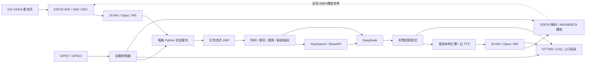
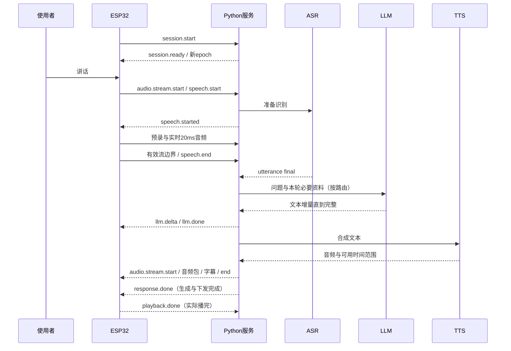

# 个人语音助手项目开发文档

文档日期：2026-11-17。项目类型：ESP32-S3 嵌入式终端 + Python 本地语音服务。面向开发、测试、运维和项目接手者。当前状态：固定语音链路功能完成，用户已确认目标板日常功能正常，按个人使用范围结项。

本文件汇总需求、实现、验证与交付边界。精确设备协议以[设备协议](voice_protocol.md)为准，执行命令以[操作指南](operations.md)和[服务端说明](../server/README.md)为准，结项状态以[当前进度](realtime_voice_progress.md)为准。本文中的历史测试数量均来自已有记录，本次文档整理未重新运行固件、云端或设备测试。

## 目录与章节要点

| 章节 | 二级内容 | 内容要点 | 需补充材料 |
| --- | --- | --- | --- |
| 1. 项目背景 | 使用背景、材料依据、术语 | 解释设备与电脑服务的职责，以及事实来源 | 正式项目起始日期待确认 |
| 2. 目标与范围 | 交付目标、范围外、验收边界 | 固定当前交付范围，区分功能完成与可选统计 | 正式版本号、最终固件标识待确认 |
| 3. 需求说明 | 功能需求、规则与异常、非功能需求 | 用需求编号连接规则、验收与源码 | 原始优先级未给出，本文仅作整理分级 |
| 4. 角色与流程 | 责任角色、日常交互、取消恢复 | 说明使用者与维护者如何操作系统 | 实际责任人姓名、交接对象待确认 |
| 5. 技术架构 | 系统图、技术选型、数据流、依赖 | 描述端云协作、音频链路和扩展位置 | 跨平台及其他账号组合按需验证 |
| 6. 模块设计 | 目录树、模块职责、硬件、资源边界 | 对应到真实文件和关键实现约束 | 载板原理图与完整电源路径待确认 |
| 7. 数据库与存储设计 | 配置、会话、Flash、数据生命周期 | 如实记录无业务数据库，列出现有结构 | 调试文件保留期限待确认 |
| 8. 接口设计 | HTTP、WS、音频包、事件、错误处理 | 给出接口摘要及有效示例，链接完整契约 | 公网鉴权方案不在当前实现范围 |
| 9. 开发计划与里程碑 | 阶段任务、依赖、工时、关键路径 | 按实际开发阶段回顾，不虚构投入时间 | 实际起止日期和工时待确认 |
| 10. 测试方案 | 环境、测试资产、用例、证据、性能 | 区分离线、主机桩、云联调和用户实测 | 原始实测日志与样本统计待确认 |
| 11. 部署与运维 | 环境、启动、配置、停止回退、日志 | 引导复现现有部署并定位常见故障 | 固化发布包和固件回滚包待确认 |
| 12. 风险与待确认 | 风险表、资料缺口 | 列出真实影响、建议角色和处理条件 | 概率、责任人、期限缺失时保留待确认 |
| 13. 项目复盘与结项 | 成果、指标、问题、经验、后续 | 记录用户结项反馈及可选改进 | 不追加新的强制验收门槛 |
| 14. 附录 | 来源索引、追溯矩阵、维护规范、检查清单 | 为接手者提供资料与回查入口 | 按后续实际维护更新 |

## 1. 项目背景

### 1.1 使用背景

本项目为个人桌面语音助手：使用者通过麦克风讲话，经语音识别、语言模型生成回答，再由扬声器播报；屏幕显示回答，两个实体按钮支持暂停、取消、翻页和连接重试。ESP32-S3 承担实时音频与设备交互，电脑承担会话与服务商接入。日常操作无需串口输入，仍依赖 Wi-Fi、运行中的电脑服务以及所选云服务。

当前作者本机链路为豆包流式 ASR 2.0 → DeepSeek → 本地曼波 GPT-SoVITS TTS。公开模板中的 `realtime_default` 保留火山 TTS；下载仓库不会自动获得作者本机配置、API 凭证、曼波引擎、权重或参考录音。

### 1.2 材料与事实优先级

| 材料 | 用途 | 使用边界 |
| --- | --- | --- |
| 当前源码、依赖锁定与配置模板 | 描述模块、接口、默认值和存储 | 模板不等于本机配置；代码存在不等于声学通过 |
| 用户于2026-11-17补充的实测反馈 | 更新功能验收与结项状态 | 用户场景结果，没有完整原始日志及统计样本 |
| 当前进度、操作指南、服务端说明 | 回查实现、运行和测试记录 | 历史“待验”仅代表该次交付时点 |
| 阶段归档 | 故障复盘与逐批证据 | 不用旧命令、旧目录代替现行操作 |

新增业务规则、量化承诺、真实人员和未提供的日期均不推测。资料缺失统一标“待确认”；验证结果标明是离线、主机检查还是真实设备反馈。

### 1.3 术语

| 术语 | 本文含义 |
| --- | --- |
| ASR / LLM / TTS | 语音识别 / 大语言模型 / 语音合成 |
| AFE / VAD / AEC | 音频前端 / 语音活动检测 / 回声消除 |
| D1 / D2 | 插话观察 / 实际插话停播并交接新回合，是本项目阶段称谓 |
| profile | 一组 ASR、LLM、TTS 选择和能力要求 |
| epoch / turn / generation | 会话代际 / 用户发言轮次 / 回复代数，用于隔离旧事件 |
| stream_id | 音频流身份；上、下行各自管理流生命周期 |
| PCM16LE / raw Opus | 16位小端PCM / 不带Ogg、WAV等容器的Opus包 |
| 首音时延 | 从某个交互起点到听见回答的时间；用户观察尚无固定起止口径 |
| 用户实测正常 | 当前设备、配置及场景可用，不延伸为所有环境均通过 |

## 2. 目标与范围

### 2.1 交付目标与完成情况

| 目标 | 当前交付 | 证据 |
| --- | --- | --- |
| 完成一条语音问答链路 | 采集、识别、生成、播报和多轮可用 | 源码、历史记录及用户确认 |
| 日常不依赖串口 | 自动监听、双按钮、字幕和连接恢复正常 | 用户目标板确认 |
| 播放中插话与取消 | D2中断与下一轮交互正常 | 用户确认，不等同完整声学校准 |
| 使用本地曼波音色 | 中文连续播报、连续播放、音色连贯正常 | 用户确认 |
| 时间与联网信息 | 关键词命中时搜索及新闻功能可用 | 用户确认及既有服务端测试 |
| 可配置与维护 | 向导、适配器、协议和操作资料具备 | 仓库实现与文档 |

### 2.2 范围外与可选后续

WakeNet唤醒词、MultiNet离线命令、设备端独立模型选择、管理网页、运行时模型切换与持久化选择不在当前交付范围。Qwen LLM、CosyVoice等其他模型或账号组合有配置或适配入口，未据此认定全部真实账号均已验证。

完整远端单讲、双讲、跨距离/音量声学统计、弱音与持续噪声专项、长期CPU/内存/任务栈趋势属于可选后续。旧计划中的20轮混合交互、3次重连、约2小时运行没有完成证据，不能记为通过，也不重新作为结项前置条件。

### 2.3 验收边界

当前功能达到个人使用目标，可以结项。近端讲话与插话功能正常，不扩大为定量误触发率、完整远端/双讲或长期稳定性认证。用户观察良好网络下回答等待通常在1秒以内，网络较差时可能为2–3秒；样本数、计时口径、中位数和P95待确认，不构成SLA。

正式版本号、对应应用/模型哈希、最终发布包与维护周期待确认。本文日期为文档整理及结项反馈日期，不虚构各阶段的执行日期。

## 3. 需求说明

### 3.1 功能需求清单

下列需求来自已有实现、文档与用户反馈。优先级为本文整理建议：P0是核心使用链路，P1是配置/维护支撑；原项目没有独立优先级基线。

| 编号 | 名称 | 用户角色 | 功能规则 | 验收标准 | 建议优先级 |
| --- | --- | --- | --- | --- | --- |
| FR-01 | 上电自动就绪 | 使用者 | Wi-Fi、会话、AFE就绪后自动监听；AEC健康且配置开启时进入D2 | 无串口也能发起问答；用户确认正常 | P0 |
| FR-02 | 自动发言边界 | 使用者 | 默认160 ms起音、400 ms预录、700 ms尾静音、30秒发言上限 | 正常短句可用，起止功能正常；用户确认 | P0 |
| FR-03 | 采集与识别 | 使用者 | 16 kHz单声道、20 ms Opus/WS上行，整轮final提交问题 | 正常讲话产生识别和一次回答；空final不编造回答 | P0 |
| FR-04 | 回答与时效查询 | 使用者 | 每轮提供北京时间，按问题路由聊天、时间或联网资料 | 关键词命中触发查询；用户确认搜索可用 | P0 |
| FR-05 | 正文与播报 | 使用者 | 完整正文显示后开始TTS；24 kHz单声道下行；曼波分段共用一流 | 文字可读、中文连续播放正常；用户确认 | P0 |
| FR-06 | 字幕与翻页 | 使用者 | 三完整行/页；按播放位置及可用cue跟随；键2接管本轮 | 字幕与按钮翻页正常；用户确认 | P0 |
| FR-07 | 键1控制 | 使用者 | 空闲短按暂停/恢复，忙时取消，长按重试 | 状态对应动作正确，长按不追加短按；按钮功能正常 | P0 |
| FR-08 | D2插话 | 使用者 | 确认后隔离旧回复、本地停播、等待匹配取消ACK再开新轮 | 插话中断、继续对话正常；用户确认 | P0 |
| FR-09 | 有界恢复 | 使用者 | Wi-Fi/会话有限重试，保留暂停意图，耗尽可人工重试 | 重连、多轮正常；旧数据不串新会话 | P0 |
| FR-10 | 搜索与新闻 | 使用者、维护者 | AnySearch与ShowAPI独立配置，资料仅用于本轮 | 命中关键词查询/播报正常；授权单独维护 | P1 |
| FR-11 | 配置管理 | 维护者 | 中文向导编辑profile，校验、备份并保存 | 合法配置可保存，错误配置拒绝，重启加载 | P1 |
| FR-12 | 诊断 | 开发、测试、运维 | 串口输入默认关闭，日志保留固定原因、身份和数字指标 | 可按阶段定位首因；日常不需要串口命令 | P1 |

### 3.2 背景、流程、异常与待确认

| 需求 | 业务背景与流程 | 异常规则 | 待确认或限定 |
| --- | --- | --- | --- |
| FR-01 | 桌面上电即用：初始化→联网→握手→监听 | 网络耗尽提示处理；硬故障不无限重连 | 其他载板未验证 |
| FR-02 | 避免动静开空轮：候选→确认→预录上传→尾静音 | 拒绝后重新静音就绪，持续噪声仍可能通过 | 误触发/漏检率未统计 |
| FR-03 | 统一识别：开流→speech.start→确认→送音→结束 | 协议、积压及连续性问题明确失败；真实空final回监听 | 其他语言/账号效果未统一验收 |
| FR-04 | 时效回答：路由→查询或直答→必要时LLM | 查询失败播报无法核实，取消释放任务 | 关键词路由不是通用工具代理 |
| FR-05 | 可听可读：收齐正文→分句/分段→合成→下发 | TTS失败保留正文，不自动重播已播放段 | 首音包含完整LLM生成及首段合成等环节 |
| FR-06 | 小屏阅读：分页→播放定位或人工翻页 | cue无效仍保留文字、音频、手动阅读 | 可见正文最多8191 UTF-8字节，超限明确截断 |
| FR-07 | 去抖→短/长按→控制器动作 | 同时按、开机按住有互斥/释放处理 | GPIO3上电/复位需松开 |
| FR-08 | 确认讲话→停播→取消ACK→新轮 | 未确认清理不开新轮，旧事件丢弃 | 功能正常不证明所有双讲场景 |
| FR-09 | 隔离旧会话→退避→新epoch→恢复模式 | 不重传失败发言、不复活旧声音 | 延迟来源未系统分项测量 |
| FR-10 | 新闻播报与具体事件求证走独立路由 | 失败不让模型凭空猜事实 | 技术可用；ShowAPI账号授权范围待确认 |
| FR-11 | 向导→检查→保存→重启8000 | 冲突、缺凭证、能力不足时拒绝保存/启动 | 设备显式profile不自动继承启动CLI覆盖 |
| FR-12 | 关联设备/服务日志→定位阶段 | 不打印凭证、音频正文或远端异常正文 | 日志保留期限、监控告警待确认 |

### 3.3 非功能需求

| 编号 | 要求 | 当前实现或边界 |
| --- | --- | --- |
| NFR-01 | 格式互操作 | 上行16 kHz、下行24 kHz、mono、PCM16LE内部表示、20 ms帧，默认raw Opus |
| NFR-02 | 资源有界 | 队列、超时、历史和文本容量有限；不跳过Opus包掩盖积压 |
| NFR-03 | 身份隔离 | epoch/turn/generation/stream校验，取消/重连后旧包不复活 |
| NFR-04 | 凭证隔离 | 云凭证在服务端；Wi-Fi配置、密钥、录音和备份不提交；无设备用户鉴权/RBAC |
| NFR-05 | 环境明确 | ESP-IDF 6.1，Python 3.11+，推荐已使用的3.12；其他环境按需验证 |
| NFR-06 | 可维护 | 按职责分目录，中文说明性注释；协议、操作、状态各有维护入口 |
| NFR-07 | 如实报告 | 不承诺未测P95、FPS、成功率或最长运行时间 |

## 4. 角色与流程

### 4.1 责任角色

下列为维护职责，不是系统账号权限；一个人可承担多个角色。姓名、交接对象和支持期限待确认。

| 角色 | 职责 |
| --- | --- |
| 设备使用者 | 讲话、阅读、暂停/恢复、取消、翻页、连接重试 |
| 固件维护者 | GPIO、驱动、前端、音频/网络任务、控制器、界面 |
| 服务端维护者 | profile、适配器、会话、协议、路由、向导 |
| 测试人员 | 区分离线、主机检查、真实API、目标板证据 |
| 运维/项目所有者 | 启停服务，管理凭证/模型/备份，处理网络/供电，决定发布归档 |

### 4.2 日常使用流程

1. 启动电脑服务，曼波组合需同时运行9880引擎与8000语音服务。
2. 设备上电，Wi-Fi、会话、前端就绪后自动监听。
3. 确认讲话并保存预录，ASR就绪后上传；尾静音或时长上限提交本轮。
4. ASR整轮final确定问题，按规则路由时间、搜索、新闻或聊天。
5. 完整正文显示后合成播放，字幕据可用时间范围随播翻页。
6. 播放完成返回监听，用户可按键控制或播放中插话。

### 4.3 按钮、取消与恢复

| 操作 | 行为 | 后续状态 |
| --- | --- | --- |
| 键1（GPIO7）空闲短按 | 暂停/恢复自动监听 | 重连保留本次运行的选择 |
| 键1忙时短按 | 取消录音/生成/播放回合 | 清理后可继续下一轮 |
| 键1长按1秒 | 清理并重新尝试连接 | 统一恢复流程重建会话 |
| 键2（GPIO3）短按/长按 | 下一页/上一页 | 本轮人工接管，新回复恢复自动跟随 |
| D2插话 | 本地确认→封禁旧回复→停播→匹配取消ACK | 有界缓存交接新轮，旧音/字幕失效 |
| Wi-Fi/服务中断 | 清理旧身份/队列，按预算退避 | 恢复原模式，耗尽提示人工处理 |

按下接GND、内部上拉；30 ms去抖，长按不追加短按，同时按不触发；开机按住需先释放。GPIO3是绑带脚，上电和复位时松开。

## 5. 技术架构

### 5.1 系统架构



图为主要处理路径，时间问题可直接产生可播报答案，不要求所有请求均经LLM。设备至主机默认局域网HTTP/WS；主机至云服务使用适配器的HTTPS/WSS。本地曼波示例绑定电脑回环9880，设备只连接电脑8000。

### 5.2 已确定选型与取舍

下表解释已实现方案，未声称曾开展正式选型评审。对照项说明差别，不代表新增开发承诺。

| 领域 | 已确定方案 | 对照与取舍 |
| --- | --- | --- |
| 终端 | ESP32-S3 N16R8、ESP-IDF 6.1、C/C++ | 其他载板需复核GPIO、PSRAM、供电，未直接验收 |
| 主机 | Python 3.11+、aiohttp | 服务商差异集中在主机；ESP32不运行云LLM或曼波权重 |
| 传输 | 双向WS、JSON控制+二进制音频 | 旧HTTP是整段兼容接口，不承担当前双向会话 |
| 编码 | 默认raw Opus，显式协商PCM回退 | Opus降低负载，PCM便于对照；二者都需背压与节奏控制 |
| 前端 | ESP-SR 2.6.1、vadnet1_medium、AFE/VAD/AEC | WakeNet/MultiNet不属于当前链路 |
| 界面 | ST7789 SPI、LVGL、三行静止分页 | 跨页/状态变化才更新正文，避免持续装饰动画 |
| TTS | 作者本机曼波，模板火山 | 曼波需本地模型且返回分段WAV；云TTS依赖账号/网络，可提供逐词数据 |
| 存储 | JSON、内存会话、Flash模型 | 无业务数据库、SQL表或迁移系统 |

### 5.3 数据流与时序



时间/直答路径可绕过LLM。曼波不是原生流式TTS：完整回答后按有界段请求WAV，首段完成即下发，最多预取下一段；同轮仅一个进行中的HTTP合成请求。默认首段40字符、后段80字符，首音仍等待完整LLM与首段合成。GPU推理、参考录音处理、传输与设备缓冲也可能影响等待，现有观察不能作唯一网络归因。

火山可提供逐词时间；曼波按整段音频时长提供近似cue，设备估计段内位置。统一协议不等于时间精度相同。无法对齐时保留音频、正文及人工翻页。

### 5.4 依赖版本

| 依赖 | 锁定/要求 | 来源 |
| --- | --- | --- |
| ESP-IDF / CMake | 6.1（锁文件6.1.0）/ 最低3.22 | 开发环境、锁文件、根CMake |
| LVGL / esp_lvgl_port | 9.3.0 / 2.9.0 | main/idf_component.yml |
| esp_websocket_client | 1.8.0 | 同上 |
| 78/esp-opus / cJSON | 1.0.5 / 1.7.19~2 | 同上 |
| ESP-SR | 2.6.1 | 同上 |
| Python / aiohttp | 3.11+（推荐3.12）/ 3.14.5 | 入口、requirements.txt |
| Windows Opus分发 | PyOgg 0.6.14a1，AMD64条件依赖 | 调用原生libopus C ABI |
| 曼波 | MamboTTS v1.2.1旧api.py | 独立安装，不包含在仓库 |
| 字体 | Noto Sans SC转换资源，OFL 1.1 | 字体来源与许可证 |

Windows Opus库可用但版本字符串为`libopus unknown`，wheel和文件哈希见服务端说明。Linux/macOS使用系统libopus；Linux与完整Python 3.11环境未实际验收。容器固定`espressif/idf:v6.1`标签，现有材料未证明镜像拉取/构建成功。

## 6. 模块设计

### 6.1 目录结构

```text
voice_assistant/
├── main/
│   ├── main.cpp                     ESP-IDF入口
│   ├── app/                         初始化、控制器、按钮、状态
│   ├── audio/                       I2S、AFE、Opus、播放与参考时线
│   ├── display/                     ST7789、LVGL、显示内存
│   ├── network/                     Wi-Fi、WS、音频协议
│   ├── fonts/                       字库、来源与OFL
│   ├── Kconfig.projbuild             固件设置
│   ├── idf_component.yml            依赖
│   └── CMakeLists.txt               源文件与DMA观察副本
├── server/
│   ├── voice_server.py              HTTP/实时入口
│   ├── configure_voice.py           中文向导
│   ├── start_voice_server.ps1        启动辅助
│   ├── core/                        配置、会话、流水线、路由
│   ├── providers/
│   │   ├── asr/                     豆包流式、Qwen批量
│   │   ├── llm/                     Chat Completions
│   │   ├── tts/                     火山、CosyVoice、GPT-SoVITS
│   │   ├── search/                  AnySearch
│   │   └── news/                    ShowAPI
│   ├── transport/                   HTTP/WS、协议、诊断
│   ├── audio/                       PCM、Opus、字幕时线
│   ├── config/                      示例、本机配置/凭证/备份
│   ├── data/                        调试输出（Git忽略）
│   └── tests/                       Python离线回归
├── tools/                           PC客户端、主机检查、构建辅助
├── docs/                            总览、状态、操作、协议、归档
├── .devcontainer/                   固定版本容器
├── partitions.csv                   Flash分区
├── sdkconfig.defaults               可公开默认配置
├── dependencies.lock                依赖锁
└── AGENTS.md                        维护约定
```

本机`sdkconfig`、虚拟环境、构建输出、凭证、录音与配置备份不属于公开源码。

### 6.2 职责与关键文件

| 模块 | 关键文件 | 职责与协作 |
| --- | --- | --- |
| 初始化 | main/app/voice_assistant_app.cpp | 初始化外设、网络、UI、控制器；main.cpp只留入口 |
| 会话控制 | main/app/conversation_controller.cpp | 状态机、轮次、自动发言、取消、D2、按钮与恢复 |
| 按钮/状态 | local_buttons.cpp、button_gestures.hpp、voice_assistant_status.hpp | 定时扫描、有限FIFO、手势及共享显示状态 |
| 音频编排 | main/audio/audio_service.cpp | 采集、播放、队列及参考/前端协作 |
| I2S与Opus | ics43434_microphone.cpp、max98357a_audio.cpp、opus_codec.cpp | 采样、播放、有效样本边界、有状态编解码 |
| 本地前端 | local_audio_frontend.cpp、automatic_utterance.hpp、barge_in_observer.hpp | AFE/VAD/AEC、起止和插话确认 |
| 参考时线 | playback_reference.cpp、reference_resampler.cpp、reference_timeline.cpp | 实际播放PCM、24→16 kHz转换、映射/配对 |
| 模型 | sr_model_store.cpp | 分区模型与打包清单校验 |
| 显示 | st7789_display.cpp、voice_assistant_ui.cpp、lvgl_memory.cpp | SPI/DMA、分页、状态、显示内存 |
| 设备网络 | wifi_station.cpp、voice_client.cpp、voice_protocol.cpp | Wi-Fi/WS、音频包、有限重试、旧事件隔离 |
| 配置 | server/core/config.py、config_editor.py、provider_registry.py | 读取/校验/冻结、备份保存、创建适配器 |
| 会话/流水线 | server/core/session.py、pipeline.py | 有限历史、ASR final、回答、合成、取消关闭 |
| 时间/查询 | realtime_info.py、news_routing.py | 北京时间、搜索/新闻意图、本轮资料 |
| 厂商 | server/providers各子目录 | 隔离云协议与本地引擎，声明实际能力 |
| 传输/音频 | server/transport、server/audio | HTTP/WS、帧头、Opus、字幕映射、诊断 |

### 6.3 硬件与接线

| 设备 | 规格/功能 | 源码GPIO |
| --- | --- | --- |
| 主控 | ESP32-S3 N16R8，16 MB Flash、8 MB Octal PSRAM | 载板标识ESP32-S3 2025-V1.4 |
| ICS-43434 | I2S麦克风 | BCLK=4，WS=5，DATA=6 |
| MAX98357A | I2S功放、8Ω/3W扬声器 | Enable/SD=8，DATA=15，BCLK=16，WS=17 |
| ST7789 | 1.54英寸、240×240 SPI | DC=9，CS=10，MOSI=11，CLK=12，BL=13，RST=14 |
| 键1/键2 | 按下接GND、内部上拉 | 7 / 3，Kconfig可配置 |

以[board_pins.hpp](../main/app/board_pins.hpp)与Kconfig为准，已有重复外设引脚静态检查与按钮占用检查。模块名称不能证明其他载板可用引脚/供电路径。完整载板原理图和双USB口电源路径待确认，不据此编造电源接法。

### 6.4 调度与扩展约束

采集、AFE feed/fetch、播放、网络、显示分工运行。20 ms为音频帧长，不等于每任务耗时；显示50 Hz为目标调度周期，不是实测FPS。按钮10 ms定时扫描，经有限FIFO交控制器，扫描回调不调用网络。

播放参考取自解码、音量处理且实际完成DMA的PCM，“已入播放队列”不能替代实际播放。构建目录生成带观察逻辑的`i2s_common.c`副本，不修改安装SDK；CMake严格检查ESP-IDF 6.1已验证语句，SDK变化时明确失败。升级时需审阅此集成点，不删除保护绕过。

内部RAM、DMA内存、PSRAM分别观测。新增源文件同步CMake/依赖；新增本地模型同步镜像、分区、清单和资源核算。新服务商放`server/providers`并复用能力/取消契约；直接生成回答和音频的对话后端须另行设计，不冒充三层独立适配器。

## 7. 数据库与存储设计

### 7.1 存储清单

项目没有业务数据库、SQL表、索引、外键、数据库用户或迁移系统。以下是实际存储结构。JSON键保留snake_case，凭证环境变量保留源码大写名称，不为统一命名修改现有契约。

| 存储 | 位置 | 生命周期与用途 |
| --- | --- | --- |
| 业务配置 | server/config/voice_config.json | 本机持久文件；缺失读example；启动冻结 |
| 云凭证 | server/config/server_secrets.json、环境变量 | 仅主机使用，文件与备份不提交 |
| 配置备份 | server/config/backups/ | 向导保存前备份，未定义自动保留期限 |
| 会话历史 | ConversationSession内存 | 按连接创建，重连不恢复旧历史 |
| 旧HTTP录音 | server/data/received_audio.pcm | /audio识别调用成功后覆盖保存，包含空转写 |
| PC工具结果 | 显式输出的WAV/JSON | 按调用者指定路径维护 |
| 固件配置 | sdkconfig | 含Wi-Fi/URL，构建输入，不公开 |
| NVS | nvs分区 | SDK初始化和网络使用，非对话数据库 |
| 前端模型 | model分区、构建清单 | 随固件/模型部署，不由服务端JSON生成 |

`profiles.<id>.asr/llm/tts`引用条目，`adapter`选择工厂，`credential_ref`引用凭证名。这是配置校验关系，没有数据库外键。兼容的`model_ref`解析出非空值时可能覆盖JSON的`model`。

### 7.2 配置字段

完整取值与校验见[业务模板](../server/config/voice_config.example.json)和[实现](../server/core/config.py)。下表用于交接，不是可直接覆盖本机文件的完整JSON。

| 字段 | 类型 | 必填/模板默认 | 说明 |
| --- | --- | --- | --- |
| schema_version | integer | 1 | 配置版本 |
| active_profile | string | legacy_http | 未显式选择时的默认组合 |
| asr / llm / tts | object | 所选组合引用项必需存在 | 按条目ID组织 |
| profiles | object | 所选项必须存在 | 组合定义 |
| `profiles.<id>.asr/llm/tts` | string | 按模式校验 | 引用条目；HTTP的TTS为none |
| `profiles.<id>.require_streaming_asr` | boolean | 按模板组合声明 | true拒绝批量ASR |
| `<provider>.adapter` | string | 所选条目必需 | 不接受未实现适配器 |
| model / endpoint / voice / resource_id | string | 按适配器要求 | 不同服务要求不同 |
| credential_ref / workspace_ref | string | 按适配器要求 | 保存引用名而非实际密钥 |
| model_ref | string | 可选 | 非空解析值优先于model |
| transport / news | object | 见下表 | 音频传输与独立新闻设置 |

| transport关键项 | 类型 | 模板默认 | 含义 |
| --- | --- | --- | --- |
| frame_duration_ms / channels | integer | 20 / 1 | 当前协议格式 |
| uplink.codec / downlink.codec | string | opus / opus | PCM须显式协商 |
| uplink.sample_rate_hz / downlink.sample_rate_hz | integer | 16000 / 24000 | 采样率 |
| uplink.bitrate_bps / downlink.bitrate_bps | integer | 24000 / 32000 | 目标码率，非总带宽 |
| vbr / dtx | boolean | true / false | 编码参数 |
| allow_pcm_fallback / fallback_codec | boolean / string | true / pcm_s16le | 当前流不静默换码 |
| idle_timeout_seconds | integer | 0 | 0持续待机，1–86400为有限待机秒数 |

| 新闻/曼波关键项 | 类型 | 模板默认 | 限定 |
| --- | --- | --- | --- |
| news.enabled | boolean | false | 不据模板推定用户本机仍关闭 |
| news.credential_ref | string | SHOWAPI_APP_KEY | 实际值不进入设备 |
| news.channel_name / max_results / timeout_s | string / integer / number | 国内最新 / 3 / 10 | 频道、每轮条数、秒数 |
| tts.mambo_local.endpoint | string | http://127.0.0.1:9880/ | 电脑回环，不是设备本机 |
| refer_wav_path / prompt_text | string | 配套路径/转写示例 | 路径按引擎电脑解释，转写与录音匹配 |
| first_segment_chars / segment_chars | integer | 40 / 80 | 各支持8–200 |
| speed / timeout_s / max_audio_bytes | number / number / integer | 1.0 / 180 / 16777216 | 合成预算累计，仍受外层120秒流水线限制 |

### 7.3 会话结构与生命周期

| 字段 | 类型 | 初始值/来源 | 用途 |
| --- | --- | --- | --- |
| selection | 不可变选择对象 | 握手解析 | 本会话服务能力 |
| epoch | 非零uint32 | 新连接随机生成 | 重连隔离 |
| turn / generation | integer | 0，随后递增 | 发言轮次/回复代数 |
| history | list[dict] | 空列表 | 有限内存上下文 |
| history[].role | string | user或assistant | 角色 |
| history[].content | string | 本轮正文 | 内容 |
| history[].interrupted | boolean | false | 打断且听取范围不确定 |
| history[].playback_confirmed | boolean | false | 匹配playback.done后确认 |

历史最多12条记录、content合计最多32000个Python字符，不是12轮或UTF-8字节。超限从头淘汰，再移除头部非user项，尽量保留问答对。搜索/新闻资料仅用于本轮，不加入历史；历史本身也不跨连接持久化。

### 7.4 Flash分区与维护

| 名称 | 类型/子类型 | 偏移 | 大小 | 用途 |
| --- | --- | --- | --- | --- |
| nvs | data / nvs | 0x9000 | 0x6000 | NVS |
| phy_init | data / phy | 0xf000 | 0x1000 | PHY初始化 |
| factory | app / factory | 0x10000 | 3M | 单factory应用 |
| model | data / spiffs | 0x310000 | 1M | 前端模型镜像，非录音盘 |

以[分区表](../partitions.csv)及构建清单为准；并非全部16 MB Flash均已分配。无OTA双应用槽或自动回滚机制。

配置、凭证及备份保留期限待确认，由维护者管理。旧HTTP录音每次覆盖；实时`/ws/voice`不会自动录制对话。发布时不包含本机密钥、备份和运行文件。

## 8. 接口设计

### 8.1 接口总览与权限

| 名称 | URL / Method | 请求/响应 | 当前权限边界 |
| --- | --- | --- | --- |
| 健康检查 | GET /ping | 无参数；200纯文本OK | 未实现设备鉴权；只证明进程路由可响应 |
| 兼容录音问答 | POST /audio | PCM16LE二进制；两行UTF-8文本 | 未实现用户登录；云凭证由主机读取 |
| 双向语音会话 | GET /ws/voice，升级WebSocket | JSON控制+二进制音频 | 最多4个活动连接，无设备身份认证/RBAC |

默认监听`0.0.0.0:8000`，未配置TLS终止，设备连接默认`http/ws`。主机调用云端HTTPS/WSS不等于设备链路已加密。固件支持配置`wss`及证书校验，但主机TLS终止、设备鉴权、Origin白名单和公网访问控制不在现有服务实现中；如改变部署范围，应另行设计。

### 8.2 HTTP健康检查与整段问答

健康请求与响应正文示例：

```http
GET /ping HTTP/1.1
Host: 192.168.1.10:8000
```

```text
OK
```

`POST /audio`参数：

| 项 | 类型/必需 | 规则 |
| --- | --- | --- |
| Content-Length | integer，必需 | 1–1000000且为偶数；需与正文长度一致 |
| 请求正文 | bytes，必需 | 16 kHz、mono、PCM16LE；不带WAV头 |
| Content-Type | 示例application/octet-stream | 接口按PCM解读，不据该头自动转码 |
| 转写响应第1行 | string | 最多96 UTF-8字节，清理换行并安全截断 |
| 回答响应第2行 | string | 最多120 UTF-8字节；两行含换行最多217字节 |

示例命令仅用于已有正确格式的测试文件，会调用真实ASR/LLM；本次未执行。仓库不附带下方`server/data/question.pcm`，执行时需替换为自己的16 kHz单声道PCM16LE录音文件路径：

```powershell
curl.exe -X POST 'http://127.0.0.1:8000/audio' `
  -H 'Content-Type: application/octet-stream' `
  --data-binary '@server/data/question.pcm'
```

成功响应示意，不保证每次生成相同正文：

```text
你好
你好，有什么可以帮你？
```

模型选择须区分入口：`--mode http`使用启动selection选择ASR/LLM，当前HTTP ASR工厂支持`qwen_batch`，TTS必须为`none`；`--mode realtime`中保留的兼容`/audio`固定Qwen→DeepSeek，不跟随WS选择。旧`audio_test_server.py`也固定旧组合。

| HTTP状态 | 现有响应文本/情况 |
| --- | --- |
| 400 | Invalid Content-Length（纯HTTP解析）、Invalid PCM16 audio length、Incomplete audio body |
| 404 | Not found / 无对应路由 |
| 500 | Speech recognition failed、Unable to save audio |
| 502 | DeepSeek request failed；为兼容旧约定，HTTP可选其他LLM也保留此文本 |

ASR调用成功后覆盖写`received_audio.pcm`；真实空转写返回“未识别到语音”及靠近麦克风重试提示，不调用LLM。不能将旧两行响应统一改写为虚构的JSON格式。

### 8.3 WS握手与配置选择

客户端首帧示例：

```json
{"type":"session.start","version":1,"profile":"realtime_default","uplink_codec":"opus","downlink_codec":"opus"}
```

| 字段 | 类型/必需 | 规则 |
| --- | --- | --- |
| type / version | string / integer，必需 | session.start / 1 |
| profile | string，可选 | 显式选择文件内组合；设备默认明确发送realtime_default |
| asr / llm / tts | string，可选 | 分别覆盖该会话的三层条目ID |
| uplink_codec / downlink_codec | string，可选 | 默认配置编码；pcm_s16le仅允许显式回退 |

响应字段摘录（实际还包含脱敏的`selection`对象）：

```json
{"type":"session.ready","session_epoch":12345,"turn_id":0,"generation":0,"uplink_codec":"opus","downlink_codec":"opus","uplink_sample_rate_hz":16000,"downlink_sample_rate_hz":24000,"frame_duration_ms":20}
```

`selection`提供profile、模式、各层公开ID/adapter/能力及可选model/voice/resource_id，不返回凭证、任意provider选项或服务端点。能力描述不代表账号授权和声学验收。

优先级：

1. 主机路径：显式`--config`优先，否则本机JSON，缺失才用example；凭证环境变量优先于密钥JSON，显式空环境值也会覆盖文件。
2. 主机启动：三层CLI覆盖 > 所选profile项；没有`--profile`时取`active_profile`。
3. WS显式profile：消息内三层覆盖 > 消息profile项；启动CLI三层覆盖不会自动替换这个显式profile。
4. WS不指定profile：继承启动selection，再应用消息内三层覆盖。`model_ref`解析出的非空旧模型变量仍可覆盖JSON model。

因此默认设备换TTS应编辑`profiles.realtime_default.tts`并重启8000；固件使用自定义profile时，应修改设备实际发送的profile。不能只改`active_profile`或启动`--tts`。连接内不静默换组合/编码，需新会话与新epoch。

### 8.4 控制事件与顺序

| 方向 | 事件 | 核心字段/含义 |
| --- | --- | --- |
| 双向 | audio.stream.start / audio.stream.end | start含身份、stream_id、codec、采样率、pre_skip_samples；end含身份、stream_id和valid_end_sample，不重复全部格式字段 |
| 端→服务 | speech.start | session_epoch、递增turn_id；等speech.started后送预录 |
| 服务→端 | speech.started | ASR就绪，本轮可上传 |
| 端→服务 | speech.end | 提交本轮；持续流另带有效sample_offset |
| 服务→端 | asr.partial / asr.segment_final / asr.utterance_final | text；只有整轮final提交一次问题 |
| 服务→端 | response.started | 身份和text_mode=complete_before_audio |
| 服务→端 | llm.delta / llm.done | text片段最多1024 UTF-8字节，done提交完整正文，不另带整篇文本 |
| 服务→端 | audio.subtitle | 回复/流身份、sequence、words、covered_sample；补时间元数据 |
| 服务→端 | audio.subtitle.unavailable | 字幕降级原因，音频和正文仍可用 |
| 端→服务 | speech.cancel | epoch、目标turn，用于录音/识别取消 |
| 服务→端 | speech.cancelled | 对应发言取消确认 |
| 端→服务 | response.cancel | 目标epoch/turn/generation；先本地停播与隔离 |
| 服务→端 | response.cancelled | 匹配身份的取消确认，迟到旧ACK不能结束新轮 |
| 服务→端 | response.done | 生成/合成/下发完成；reason可为complete、empty_utterance、tts_failed |
| 端→服务 | playback.done | 实际播完后的身份确认；不以response.done替代 |
| 服务→端 | session.closed | 有限待机结束时reason=idle_timeout，正常关闭 |

字幕示例假设正文“你好。世界。”已在`llm.done`提交：

```json
{"type":"audio.subtitle","session_epoch":12345,"turn_id":1,"generation":1,"stream_id":4,"sequence":0,"text_offset":0,"text":"","words":[{"text":"你好","start_sample":0,"end_sample":12000,"text_byte_offset":0}],"covered_sample":12000}
```

sample按有效24 kHz PCM计数；UTF-8字节偏移不是字符序号。固定正文模式中顶层text为空，不用第一批字幕覆盖全文。曼波段级cue复用该通道，不能把words字段名当作模型逐词对齐证据。详细边界以[设备协议](voice_protocol.md)为准。

### 8.5 二进制音频包

固定小端32字节头，后跟一个20 ms raw Opus包或PCM16LE块：

| 字段 | 类型 | 偏移 | 含义 |
| --- | --- | --- | --- |
| version | u8 | 0 | 1 |
| kind | u8 | 1 | 1上行、2下行 |
| header_bytes | u16 | 2 | 32 |
| session_epoch | u32 | 4 | 当前连接身份 |
| stream_id | u32 | 8 | 当前流身份 |
| turn_id | u32 | 12 | 持续上行0，下行为回复轮次 |
| generation | u32 | 16 | 上行0，下行为回复代数 |
| sequence | u32 | 20 | 每流从0连续递增 |
| sample_offset | u64 | 24 | 解码样本起点，包含编码前瞻时间线 |

payload长度为1–1275字节。PCM上行320样本/640字节，下行480样本/960字节；Opus长度可变。正确处理pre-skip、尾包补零和valid_end_sample，不能直接透传WAV/Ogg/WebM。错误身份、顺序和样本位置必须拒绝。

### 8.6 错误、预算与关闭

现有WS错误最小结构：

```json
{"type":"error","code":"voice_session_failed"}
```

握手阶段不保证有身份字段；流水线错误通常附epoch/turn/generation，例如：

```json
{"type":"error","session_epoch":12345,"turn_id":1,"generation":1,"code":"tts_failed"}
```

| 公共code | 含义 |
| --- | --- |
| voice_session_failed | 握手、协议或外层服务失败 |
| uplink_backlog | 上行持续积压 |
| asr_events_failed | ASR事件读取失败 |
| asr_final_failed | ASR结束/最终识别失败 |
| tts_failed | 合成失败，可保留正文 |
| response_failed | 其他回复生成失败 |

日志内category不是公开code，不新增不存在的统一message/request_id字段。满4连接时升级前HTTP 503，正文`Voice session capacity reached`；升级后外层失败通常关闭1008，ASR收尾失败1011；服务关停1001，正常待机1000。

| 限制 | 当前值/行为 |
| --- | --- |
| 初始握手 / WS心跳 | 15秒 / 20秒；不与设备20秒重连握手预算混同 |
| 输入JSON控制消息 | 会话建立后控制消息最多8192字节；首个session.start及底层WS消息受16384字节上限约束 |
| 发言 / 输入流数 | 30秒 / 每连接最多1000个且不复用stream_id |
| 上行队列 | 25项，约500 ms音频，控制也占项 |
| 队列满等待 / 积压年龄 | 最多100 ms；达到750 ms明确失败，不丢包继续 |
| 回复流水线 | 120秒总预算，不因曼波分段重置 |
| speech.cancel清理 | 服务端5秒上限；response.cancel不共用这个清理总超时，按现有清理/下行写入超时处理 |
| 设备D2交接 | 取消/开新轮共享握手预算默认2秒，不等于服务端取消清理预算 |
| 设备可见正文 / 待消费cue | 8191 UTF-8字节 / 最多512锚点，时间戳限180秒 |

协议v1为现行基线，归档中的input.commit、turn.interrupt等草案名称不作为当前接口。

## 9. 开发计划与里程碑

### 9.1 阶段任务回顾

这是已完成项目的过程整理，不是重新启动开发。各阶段准确起止日期、个人投入工时与实际负责人分配未完整记录，统一待确认；不把当前仓库提交日期当作项目开始日期。

| 阶段 | 任务/子任务 | 责任角色 | 前置依赖 | 工时 | 建议优先级 | 验收/结果 | 主要风险 |
| --- | --- | --- | --- | --- | --- | --- | --- |
| 需求分析 | 桌面语音目标、硬件、自动监听/插话、最终固定链路范围 | 项目所有者 | 使用目标 | 待确认 | P0 | 范围已收敛 | 需求持续扩展 |
| 设计 | 设备/主机分工、profile、协议、队列、取消身份、模型分区 | 固件/服务端维护者 | 需求 | 待确认 | P0 | 方案与代码一致 | 资源、协议边界 |
| 开发P1/P2 | 配置、适配器、WS/Opus、会话、取消、PC客户端 | 服务端维护者 | 设计、服务权限 | 待确认 | P0 | 既有离线/云小样本证据 | 账号/地域差异 |
| 开发P3/P4 | 采集播放、界面、AFE/VAD、起止、参考/AEC/D2 | 固件维护者 | 硬件录放、服务协议 | 待确认 | P0 | 当前板功能正常 | 调度、供电、声学 |
| 集成P5 | 三行阅读、双按钮、自动恢复、字幕降级 | 双端维护者 | 链路和前端 | 待确认 | P0 | 用户确认 | 迟到包与状态竞争 |
| 联调 | 曼波、联网、新闻、按钮、重连、多轮 | 开发/测试/使用者 | 双端部署 | 待确认 | P0 | 用户确认实际可用 | 9880/8000启停与网络 |
| 测试 | 离线回归、主机检查、目标板功能和体验 | 测试/使用者 | 联调 | 待确认 | P0 | 分层记录证据 | 把桩或小样本误作全面验收 |
| 交付结项 | README、运行文档、开发说明、已知限制 | 项目所有者 | 用户确认范围完成 | 待确认 | P1 | 2026-11-17决定结束项目 | 正式版本/发布包未固化 |

### 9.2 甘特式依赖视图

M1–M6是逻辑阶段，不是等长周数或真实日历；●为主要活动，○为可交叉活动。

| 工作 | M1需求 | M2设计 | M3开发 | M4联调 | M5测试 | M6交付 |
| --- | --- | --- | --- | --- | --- | --- |
| 范围与硬件确认 | ● | ○ |  |  |  |  |
| 架构/协议/配置 |  | ● | ○ |  |  |  |
| 服务端与设备模块 |  | ○ | ● | ○ |  |  |
| 集成/问题定位 |  |  | ○ | ● | ○ |  |
| 回归与用户实测 |  |  | ○ | ○ | ● |  |
| 文档和结项 |  |  |  | ○ | ○ | ● |

关键依赖为：硬件录放正常 → 服务配置可用 → WS/Opus连通 → 自动起止 → 参考/AEC与D2交接 → UI/按钮/恢复集成 → 用户确认。单项接口或单次构建成功不能跳过后续集成证据。

### 9.3 可追溯里程碑

| 里程碑 | 记录 |
| --- | --- |
| P1–P5 | 目标/过程在总体规划、当前进度与归档；准确逐阶段起止日期待确认 |
| 2026-11-14仓库提交 | 2c1ca56初始入库，5779503环境/许可/使用文档修正；不代表全部开发发生在当天 |
| 2026-11-17用户结项反馈 | 确认固件、曼波、查询/新闻可用，接受当前使用限制 |
| 正式版本发布 | 版本号、Release/Tag、固件和模型哈希待确认；本次没有代为提交、推送或发布 |

## 10. 测试方案

### 10.1 范围、环境与证据层级

测试对象是当前固定设备链路，不包含所有云账号、所有载板、完整声学校准或跨平台生产认证。当前硬件环境见6.3，主机Windows/Python 3.12，固件ESP-IDF 6.1；实测Wi-Fi、房间声学、距离/音量、最终固件哈希与完整日志未逐项提供，待确认。

| 层级 | 覆盖 | 已有结果与边界 |
| --- | --- | --- |
| Python离线回归 | 配置、provider、WS、Opus、流水线、字幕、搜索、新闻、日志 | 进度记录407项通过；本次未重跑 |
| C++/LVGL主机检查 | 按钮、UI、控制器、Wi-Fi、音频与参考、前端、内存 | 历史包括按钮2185断言、UI223、真实LVGL637等；不同批次不相加 |
| 真实云小样本 | 火山组合、取消/多轮、AnySearch与LLM | 既有小样本接通记录，不能推广所有账号 |
| 用户目标板 | 自动监听、起音、三行字幕、按钮、取消、D2、重连、多轮 | 用户于本次会话确认功能正常 |
| 用户曼波/查询体验 | 中文连贯、插话/连续播报、搜索/新闻命中 | 用户确认；英文可能单词读或逐字母读 |
| 性能/声学统计 | P95、误触发率、跨距离双讲、长期资源 | 未量化；不是当前结项必补项 |

固件构建、烧录、串口监视及实际服务由用户执行，本次文档整理没有执行这些操作。历史主机桩不模拟真实GPIO、双核调度、供电或声学环境；真实LVGL主机渲染也不替代面板效果。

### 10.2 测试资产与命令

| 测试资产 | 对应实现/重点 |
| --- | --- |
| server/tests/test_voice_config.py、test_configure_voice.py | 配置能力、优先级、保存与校验 |
| test_pipeline.py、test_voice_websocket.py、test_voice_silent_utterance.py | 会话、空识别、取消、错误和生命周期 |
| test_opus_protocol.py、test_voice_uplink_backpressure.py、test_downlink_pacing.py | 编码格式、连续性、积压和节奏 |
| test_gpt_sovits.py、test_volcengine_tts.py、test_streaming_providers.py | 厂商契约、分段、合成和关闭 |
| test_subtitle_timeline.py、test_diagnostic_logging.py | 对齐、降级、诊断与敏感信息 |
| test_anysearch.py、test_showapi_news.py、test_news_routing.py、test_news_pipeline.py | 搜索/新闻契约、路由与失败 |
| tools/check_local_buttons.py、check_device_controls.py、check_conversation_lifecycle.py | 主机驱动/控制器/恢复 |
| tools/check_automatic_utterance.py、check_barge_in_observer.py、check_local_frontend.py | 起止、插话和前端 |
| tools/check_playback_progress_clock.py、check_playback_reference.py及reference系列 | DMA进度、参考和映射 |
| tools/check_audio_driver.py、check_microphone_timing.py、check_memory_diagnostics.py | 音频驱动、时序、资源诊断 |

现有Python离线回归命令，需已安装依赖：

```powershell
cd C:\esp-project\voice_assistant
.\.venv-voice\Scripts\python.exe -m unittest discover -s server/tests -t server -v
```

主机固件检查脚本依赖对应编译器和本机头文件环境，先阅读各脚本及操作指南，不把单一裸C++编译命令当通用测试入口。PC工具`tools/voice_client.py`输入16 kHz mono PCM16 WAV、输出24 kHz WAV与可选报告；它不播放音频，也不发送playback.done，文件生成不能证明用户听完。

### 10.3 功能与异常用例

以下为可复用的用例说明，不伪装成已逐条执行的原始记录。用户“功能正常”覆盖模块层面，未提供每一步的独立日志；“离线/源码”表示已有回归或实现规则。用例优先级为维护建议。

| 编号 | 模块 | 前置条件 | 步骤 | 预期结果 | 优先级 | 当前证据 |
| --- | --- | --- | --- | --- | --- | --- |
| TC-01 | 自动监听 | 双端与AFE就绪 | 上电，不输入串口，讲话 | 自动识别并播报 | P0 | 用户确认 |
| TC-02 | 起音 | 自动监听 | 短促动静，再说正常短句 | 过滤短促候选，正常短句可起轮 | P0 | 功能用户确认，场景见历史检查 |
| TC-03 | 字幕 | 多页回答 | 观察正文、播报、跨页 | 正文不被首批cue缩短，可按播放翻页 | P0 | 用户确认字幕可用 |
| TC-04 | 键2 | 多页回答 | 短按/长按，后开新轮 | 下/上页，手动接管本轮，新轮恢复 | P0 | 用户确认按钮可用 |
| TC-05 | 键1 | 空闲与忙状态 | 暂停、恢复，忙时取消 | 模式正确，旧音停止，下轮可用 | P0 | 用户确认 |
| TC-06 | D2 | 正在播报 | 近端讲话插话 | 停旧音、取消旧轮、交接新轮 | P0 | 用户确认 |
| TC-07 | 重连 | 已连接 | 中断后恢复网络/服务 | 有界重连，旧轮不复活 | P0 | 用户确认重连功能 |
| TC-08 | 暂停意图/耗尽 | 暂停或重试耗尽 | 恢复网络/键1长按 | 保持意图，人工动作重开预算 | P1 | 控制器主机检查，逐场景实测日志待确认 |
| TC-09 | 曼波 | 9880、8000运行 | 长答、多轮、连续播报与取消 | 中文连贯、音色一致、中断后可继续 | P0 | 用户确认 |
| TC-10 | 英文 | 曼波运行 | 含TikTok等英文的回答 | 可识别词正常读，其余可能逐字母 | P1 | 用户已观察，属于已知表现 |
| TC-11 | 查询路由 | 服务配置可用 | 问时间、新闻、事件、闲聊 | 按规则命中查询，普通聊天不强制搜 | P0 | 用户确认搜索/新闻，时间另有代码回归 |
| TC-12 | 查询失败 | 模拟超时/无结果 | 触发查询并取消或令其失败 | 明确无法核实，释放任务，下轮正常 | P1 | 离线回归 |
| TC-13 | 空ASR final | 模拟真实空final | 提交空识别结果 | empty_utterance，未调用LLM/TTS，回监听 | P1 | 离线回归 |
| TC-14 | TTS失败 | 模拟9880拒绝/错误WAV | 提交正常问题 | 固定错误分类，正文保留，不复活旧音 | P1 | 离线回归 |
| TC-15 | 旧事件 | 新epoch/新轮已建立 | 注入旧音、旧字幕、旧ACK | 不污染新轮 | P0 | 主机/离线回归 |
| TC-16 | 非法帧/积压 | 模拟客户端 | 错序号/位置，或持续慢消费 | 明确错误关闭，不跳Opus包继续 | P0 | 离线/主机检查 |
| TC-17 | 容量 | 4个活动会话 | 请求第5个WS | 升级前503 | P1 | 代码约束/协议；实际容量性能未验收 |
| TC-18 | 配置/profile | 编辑副本 | 切TTS，校验保存，重启 | 显式设备profile正确，不误以CLI改设备 | P1 | 向导/入口回归 |
| TC-19 | 日志敏感信息 | 模拟凭证/错误正文 | 触发失败，检查日志 | 固定类别，不输出秘密或正文 | P1 | 脱敏回归 |
| TC-20 | 版本/兼容 | 旧Python模拟、codec对照 | 运行入口、协商Opus/显式PCM | 旧解释器拒绝；无隐式换码 | P1 | 离线回归，完整3.11运行待验 |
| TC-21 | 声学统计 | 受控房间/测量 | 远端/双讲/跨音量距离 | 记录真实效果和误触发数据 | P2 | 未系统执行，可选后续 |
| TC-22 | 长期资源 | 长期部署需求 | 混合待机与对话，观察资源 | 获得趋势与失败样本 | P2 | 未形成统计，可选后续 |

### 10.4 权限、兼容与性能

当前无设备账号/鉴权，因此不编造“无权限返回401/403”的用例。现有权限检查是服务端配置、云凭证和能力可用性，不等于客户端身份认证。若未来增加鉴权，再增加登录/过期/角色用例。

兼容性基线为当前ESP32-S3板、ESP-IDF 6.1、Windows/Python 3.12及已用服务组合；其他载板、Python 3.11完整运行、Linux/容器、Qwen/CosyVoice账号按需验证。

性能若后续优化，应在同一时钟内分别记录：提交→ASR final、final→完整正文、首段TTS请求→音频、设备收到/播放、D2确认→停播→ACK→新首包。不同电脑与设备绝对时间戳不直接相减。补齐计时起止、样本数、环境后再计算中位数/P95；显示调度、网络码率、服务发送结束均不能替代实测FPS、总带宽或声学首音。

## 11. 部署与运维

### 11.1 部署基线

设备与电脑应在可互访网络，ESP32使用电脑可达的局域网地址。`192.168.1.10`只是公开示例，不是已确认的本机IP。电脑运行8000服务；曼波组合另需9880引擎及其独立Python/模型。当前一键包安装说明面向Windows/NVIDIA，完整资源与显卡要求见[曼波使用说明](../server/README.md#本地曼波-tts)，不把未验证平台写成已支持部署。

以下命令为用户/维护者操作说明，本次整理未执行。当前本机项目路径为`C:\esp-project\voice_assistant`；其他电脑需改成自己的实际目录。

### 11.2 首次准备与配置

仅在尚未创建Python环境时执行，已有环境先查看其版本，不直接覆盖：

```powershell
cd C:\esp-project\voice_assistant
py -3.12 --version
py -3.12 -m venv .venv-voice
.\.venv-voice\Scripts\python.exe -m pip install -r server/requirements.txt
```

进入向导管理本机配置，未创建业务文件时从模板开始；不用示例文件覆盖既有密钥：

```powershell
cd C:\esp-project\voice_assistant
.\.venv-voice\Scripts\python.exe server\configure_voice.py
```

选择设备实际请求的`realtime_default`，配置所选ASR/LLM/TTS及凭证；曼波需匹配引擎所在电脑的参考WAV路径、转写和语言。新闻/搜索可按独立开关管理，不需要把Key发到聊天或写进固件。真实业务配置见向导，字段见[服务端配置说明](../server/README.md#新手配置)。

### 11.3 启动与健康确认

曼波组合需要两个PowerShell窗口同时运行：先在窗口A启动9880模型引擎，再在窗口B启动8000语音服务。以下为当前电脑路径；其他电脑应替换安装目录，并核对模型、参考录音及转写是否配套。

#### 11.3.1 窗口A：启动曼波TTS模型（9880）

使用曼波自带的`runtime\python.exe`，与语音服务的`.venv-voice`分开：

```powershell
cd C:\esp-project\MamboTTS-v1.2.1-full\GPT-SoVITS
.\runtime\python.exe .\api.py `
  -a 127.0.0.1 -p 9880 `
  -s ..\models\manbo_e8_s168.pth `
  -g ..\models\manbo-e10.ckpt `
  -dr ..\models\refer.wav `
  -dt "大家好，欢迎来到我的频道，今天给大家分享一个有趣的内容" `
  -dl zh `
  -fp -sm close -mt wav -st int16 `
  -cp "，。？！；：、…,.;?!"
```

看到`Uvicorn running on http://127.0.0.1:9880`表示引擎已监听。**保持窗口A运行，再另开窗口B；不要关闭引擎后在同一个窗口启动语音服务。** 当前适配器使用旧`api.py`的`POST /`和非流式WAV/int16，不替换为另一版本`/tts`或OGG输出。更换参考录音时同步修改`-dr/-dt/-dl`和服务端对应配置；安装与参数说明见[曼波引擎说明](../server/README.md#3-窗口-a-启动-9880-曼波引擎)。

#### 11.3.2 窗口B：启动语音服务（8000）

新开PowerShell，在项目根目录检查配置；检查通过后执行最后一行启动服务：

```powershell
cd C:\esp-project\voice_assistant
.\.venv-voice\Scripts\python.exe server\voice_server.py --mode realtime --profile realtime_default --check-config
.\.venv-voice\Scripts\python.exe server\voice_server.py --mode realtime --profile realtime_default
```

窗口B使用语音助手自己的`.venv-voice\Scripts\python.exe`。设备请求默认profile时，本机`profiles.realtime_default.tts`应为`mambo_local`，否则仍使用该profile当前配置的其他TTS；只改启动命令的profile不能替代设备实际选择。

#### 11.3.3 确认与重启

设备连接电脑8000，不直接连接9880。按需要检查`/ping`、正常问答、取消与下一轮。`--check-config`不监听、不访问9880、不实际合成或查询；`/ping`成功也不证明云服务与引擎可用。首次合成验证命令见[设备播放验证](../server/README.md#5-验证合成与设备播放)。

仅服务端配置变化时，在窗口B按Ctrl+C停止8000并重新执行启动命令，窗口A的曼波继续运行；云TTS组合不需要9880。以上为文档中的用户操作命令，本次未实际启动服务或模型。

### 11.4 固件部署

当前开发机使用根`sdkconfig`、`build\barge-in-test`、COM7、115200 baud。以下由用户在ESP-IDF PowerShell终端执行，实际串口不同需替换：

```powershell
cd C:\esp-project\voice_assistant
idf.py -B build\barge-in-test build
idf.py -B build\barge-in-test -p COM7 -b 115200 flash monitor
```

新克隆且没有本机sdkconfig时，先按[首次配置](operations.md#新克隆与默认插话固件)执行`set-target esp32s3`与`menuconfig`，填写自己的Wi-Fi、主机URL和接线。已有项目不要无故重新set-target，它会重新生成配置。默认面向N16R8、QIO/80 MHz、Octal PSRAM、本地VAD/AEC/D2。

应用、模型镜像与清单须来自同一构建；涉及模型/分区首次部署使用完整flash，不以仅app-flash代替。只改服务端模型/新闻配置不需重烧固件。本文为文档变更，无需因此重新构建或烧录。

### 11.5 配置项与环境变量

| 位置/名称 | 用途 | 操作边界 |
| --- | --- | --- |
| Voice Assistant → Basic setup | Wi-Fi、主机URL、profile、增益/音量、按钮 | 固件配置变化需重新构建/烧录 |
| Advanced audio and diagnostics | VAD/AEC/D2、预录、起音、调试 | 未改变场景时保留已用参数 |
| main/app/board_pins.hpp | 外设引脚 | 改线前核对硬件，不只改注释 |
| server/config/voice_config.json | 组合、端点、声音、查询开关 | 启动冻结，改后重启8000 |
| server/config/server_secrets.json | 本机密钥及兼容变量 | 环境变量同名优先，不提交 |
| VOLCENGINE_ASR_API_KEY | 豆包ASR凭证引用 | 使用豆包时需要 |
| DEEPSEEK_API_KEY | DeepSeek凭证引用 | 使用该LLM时需要 |
| VOLCENGINE_TTS_API_KEY | 火山TTS凭证引用 | 使用火山TTS时需要 |
| DASHSCOPE_API_KEY / DASHSCOPE_WORKSPACE_ID | Qwen等所需凭证/空间 | 按适配器与账号要求 |
| ANYSEARCH_API_KEY | 可选搜索Key | 匿名限额与可用性以实际服务为准 |
| SHOWAPI_APP_KEY | 新闻API凭证 | 用户已确认功能可用；账号授权仍独立确认 |
| DASHSCOPE_ASR_MODEL / DEEPSEEK_MODEL | 兼容模型名覆盖 | 检查是否覆盖JSON model |
| OPUS_LIBRARY | 显式原生Opus库路径 | Python/动态库架构一致；优先于系统/PyOgg查找 |

本地曼波HTTP接口无需云TTS Key，但ASR/LLM仍按选择需要对应凭证。不存在项目自动读取任意技能目录`.env`的配置契约。

### 11.6 停止、升级与回退

8000服务在窗口B按Ctrl+C正常停止，修改配置后用原命令重启；不误关窗口A。需要停止整套本地服务时，先停止语音服务，再正常关闭所属引擎进程，避免强杀未知端口所有者。

配置回退：停止8000 → 从`server/config/backups/`选取实际存在且对应的备份 → 恢复需要的业务配置/凭证文件并校验 → 重启并验证一次问答。备份名、具体回退版本和保留期限取决于本机文件，未在本文虚构。模型名兼容覆盖也应一起核对。

曼波切回火山：向导将本机`profiles.realtime_default.tts`改为`volc_default`，填对应凭证、检查后重启8000；不覆盖整份配置，不需固件重烧。固件采用单factory分区，没有OTA自动回退。完整旧镜像/源码/模型/配置回滚包尚未提供，按需归档，不能承诺一键回滚。

### 11.7 日志、观测与常见故障

设备日志在串口监视终端，服务日志在Python运行终端；没有默认承诺日志轮转/归档服务。按epoch/turn/generation/stream关联，区分首因和后续连带错误。串口诊断输入需显式启用，正常使用不用启用。

| 日志/指标 | 用途 |
| --- | --- |
| voice_failure first=1 | 首因、阶段和固定类别 |
| voice_asr_result / voice_asr_summary | 真实空final、音频/队列、发送与事件循环 |
| tts_reason / tts_http_status / tts_segment | 引擎拒绝、超时、格式、段请求与音频时长 |
| subtitle_state / subtitle_timing | 跟随或降级、上游/排队/发送时间 |
| local_frontend / aec_pairing / reference_alignment | 前端、参考配对和数字时线健康，不等同声学评分 |
| memory / audio_task_stacks | 内部RAM/DMA/PSRAM、最大块、分配失败、栈趋势 |
| display_perf | LVGL刷新提交诊断，不是面板FPS |

| 现象 | 优先排查与处理 |
| --- | --- |
| 曼波connection_refused | 窗口A是否仍运行、9880与endpoint一致；只开8000无法合成 |
| 9880已占用 | GUI可能已有引擎，确认归属后只保留一个实例 |
| 改模型仍旧声音 | 修改的是设备显式profile吗，8000重启了吗，model_ref是否覆盖 |
| 设备连不上 | LAN IP、端口、防火墙和Wi-Fi；设备URL不写127.0.0.1 |
| WAV错误/音色不对 | 核对旧POST /、WAV/int16、模型版本、参考录音及转写 |
| 好网快、差网慢 | 先记录环境与阶段时延；不能仅靠单一快照认定某模块根因 |
| 字幕不准/不跟随 | 检查cue与降级原因；曼波分段精度有限，手动阅读仍可用 |
| 模型校验失败 | 同一build的应用、模型、分区清单与完整flash |
| Wi-Fi复位/brownout | 查复位首因、供电和线材，不能关闭brownout掩盖电源问题 |
| GPIO3开机异常 | 上电/复位先松键2，核对绑带脚状态 |
| 偶发AFE警告 | 联合持续性、队列、资源、时线和实际效果判断，不单凭一条警告认定失效 |

### 11.8 交付/再次部署检查清单

下列供未来复现或发布使用，不要求为本次文档整理重新部署。

- [ ] 记录目标板、代码版本、固件/模型哈希和本机配置位置。
- [ ] 所选ASR/LLM/TTS配置校验通过；曼波时9880和8000同时运行。
- [ ] 设备主机IP可达，profile与预期一致；没有把回环地址写入设备主机URL。
- [ ] 做一轮问答、取消、下一轮与按钮检查；变化涉及恢复时补相应场景。
- [ ] 发布包不包含密钥、sdkconfig、备份或录音；保留MIT/OFL及第三方说明。
- [ ] 保留可用版本资料；如没有回滚包，明确记录未提供，不宣称自动回滚。

## 12. 风险与待确认

### 12.1 风险清单

优先级为本文维护建议；未提供发生概率不估算百分比，责任角色是建议分工而非已分配人员。除当前已接受的限制外，实际负责人、截止日期均待确认，不以资料缺口重新阻塞个人项目结项。

| 编号 | 类型 | 描述与影响 | 概率/证据 | 建议优先级 | 建议措施 | 责任角色 | 截止时间 |
| --- | --- | --- | --- | --- | --- | --- | --- |
| R-01 | 安全风险 | 密钥、Wi-Fi配置及备份被公开 | 概率待确认 | 高 | 保持Git忽略，发布仅含占位模板，核对变更 | 维护者 | 待确认；每次发布时 |
| R-02 | 上线/安全风险 | 默认0.0.0.0且无设备鉴权/TLS，扩大可达范围会改变信任边界 | 当前架构事实，暴露概率待确认 | 高（若扩大部署） | 当前局域网用途；公网/多人部署另设鉴权与TLS设计 | 部署维护者 | 待确认；扩大范围前 |
| R-03 | 依赖风险 | 网络条件影响回答等待，实际也含LLM、TTS、缓冲等阶段 | 用户观察，概率未统计 | 中 | 保留体验限制，需要优化再分段测时 | 维护者 | 待确认；按需 |
| R-04 | 技术风险 | AEC仅近端主观效果与插话功能确认，跨场景未量化 | 未系统测量 | 中 | 不宣称全面声学验收，按使用变化补测 | 音频维护者 | 待确认；可选 |
| R-05 | 技术风险 | 长期内存、栈和队列趋势未知 | 无完整统计 | 中 | 长期部署需要时再采集趋势 | 维护者 | 待确认；可选 |
| R-06 | 依赖风险 | 新闻账号权限、终端播报授权、额度和费用不由可用性证明 | 技术已实测，授权材料待确认 | 中 | 分开维护账号授权与技术状态；查平台条款/账号材料 | 账号所有者 | 待确认；实际使用时 |
| R-07 | 依赖/兼容风险 | SDK的I2S源码变化使观察副本生成失败 | 明确集成约束 | 中 | 固定6.1，升级审阅并回归，不删保护 | 固件维护者 | 待确认；升级时 |
| R-08 | 上线风险 | 固件/模型/配置不配套或缺完整回滚包 | 概率待确认 | 中 | 同一build部署，记录哈希，按需固化回滚资料 | 项目所有者 | 待确认；再次发布时 |
| R-09 | 需求风险 | 把已结束的个人项目扩展成唤醒、离线命令、管理系统 | 后续意图未给出 | 低 | 单独立项/讨论扩展，不混入现行验收 | 项目所有者 | 待确认；范围变化时 |
| R-10 | 进度/资料风险 | 正式版本、人员、日期、工时未完整归档 | 已知缺口 | 低 | 标待确认，不倒推虚构甘特日期或成本 | 项目所有者 | 待确认；按需归档 |
| R-11 | 技术/硬件风险 | 异常板Wi-Fi故障与电源路径未作器件级根因确认 | 用户推测和电压观察 | 低（当前正常板） | 将故障板与正常验收板区分，保留事实/推测 | 硬件所有者 | 待确认；复用故障板时 |
| R-12 | 依赖风险 | 英文未知词拼读、曼波cue仅段级，影响自然度/翻页精度 | 用户观察/实现约束 | 低 | 保留使用说明，可按需换已支持TTS | 使用者/维护者 | 待确认；按需 |
| R-13 | 兼容风险 | Linux/容器、完整3.11、其他账号及Opus上游版本未全面核实 | 支持边界已记录 | 低 | 不扩张验收范围，移植时核对运行与库来源 | 移植维护者 | 待确认；按需 |

ShowAPI的既有接口说明提示终端展示用途限制。用户已确认新闻功能能用，但未提供账号/书面授权材料，不能把两者合并为“授权已确认”。相关依据见[服务端新闻说明](../server/README.md#showapi-新闻-api)，不是本次新增的功能验收任务。

### 12.2 待补充材料

| 编号 | 材料 | 用途 | 缺失时的处理 |
| --- | --- | --- | --- |
| Q-01 | 正式版本号/Tag、代码与固件/模型哈希 | 精确复现最终实测版本 | 当前称“结项文档基线”，不称已发布v1.0 |
| Q-02 | 原始测试日志、计时起止、样本数、网络/房间条件 | 建立性能/声学统计 | 保留用户主观结果，不给P95或成功率 |
| Q-03 | 阶段起止日期、实际工时、真实责任人 | 组织管理与成本复盘 | 计划只表达依赖，日期/工时待确认 |
| Q-04 | 载板原理图、供电路径与故障板检查 | 电源/硬件根因 | 仅记录用户电压观察和Wi-Fi损坏推测 |
| Q-05 | 新闻API、模型/音色、参考录音授权材料 | 第三方使用范围 | 不据功能可用或根MIT许可推断授权 |
| Q-06 | 运行文件保留期限、维护期、交接对象 | 后续运维 | 不虚构监控服务、SLA或维护承诺 |
| Q-07 | 源码、配置、模型与旧镜像的本机归档位置 | 再次安装与回退 | 标未固化；当前不宣称自动回滚 |

## 13. 项目复盘与结项

### 13.1 目标完成与成果

项目已完成ESP32-S3终端与电脑服务的一条固定语音链路，包含模块化驱动/音频前端、统一WS协议、有状态Opus、ASR→LLM→TTS适配、完整回答阅读、三行字幕、双按钮、D2插话、取消和有界恢复。曼波、时间/联网查询和新闻路由已接入，用户确认当前功能正常并决定结束项目。

主要交付物为固件源码、Python服务/向导/测试、PC工具、模型打包规则、公开配置模板、MIT许可、字体来源/OFL，以及本开发文档、操作说明、协议和历史记录。外部引擎、权重、参考录音及私人凭证另行安装/维护，未纳入仓库。

### 13.2 指标与证据

| 项目 | 已知结果 | 不可扩大解释 |
| --- | --- | --- |
| 自动监听/按钮/字幕/重连/D2/多轮 | 用户确认当前板正常 | 不是每一内部异常分支逐项实测 |
| 曼波中文连贯、连续播放、音色、插话 | 用户确认正常 | 不保证任意文本、设备或并发负载 |
| 好/差网络下回答等待 | 用户观察通常1秒内 / 可能2–3秒 | 非固定起点统计、最大值或P95，无唯一因果诊断 |
| 英文播报 | 可识别词按词读，其他可能逐字母，如TikTok | 是当前TTS表现，不是ASR识别错误结论 |
| AEC | 近端讲话主观无明显差效果，插话功能正常 | 非完整远端/双讲/误触发率/距离音量统计 |
| 搜索/新闻 | 命中关键词可实际使用 | 不保证任意追问触发、来源实时准确或账号授权 |
| 服务离线测试 | 最近已有记录407项通过 | 本次未重跑，不累加不同批次数量 |

### 13.3 主要问题、原因与处理

按对使用的历史影响排序。归档是当时证据，未重新诊断每一次旧故障。

| 影响 | 问题 | 事实/推断 | 已有处理与经验 |
| --- | --- | --- | --- |
| 高 | Wi-Fi阶段复位/异常板、电压偏低 | 曾有电压观测；用户认为电脑USB输出偏低、充电宝较高；此前操作致Wi-Fi异常为推测 | 使用正常板完成当前验证；器件级根因未确认，不写已证实损坏 |
| 高 | 历史音频卡顿、看门狗、参考/前端配对问题 | 归档有诊断与多轮调度/背压修正；不能概括每次故障均同一根因 | 有界队列、参考时线、任务预算/核分工与首因日志，先分层再判断 |
| 中 | 字幕批次覆盖正文/时间晚到 | 实现和复盘确认显示/元数据边界问题 | 完整正文独立提交、cue只定位、元数据失败仍可阅读/听音 |
| 中 | TTS边界事件350/351被当非法字幕 | 服务日志与解析器回归记录 | 分离句边界与真正字幕数据，保留降级与回归 |
| 中 | 8000运行但曼波9880已关闭 | 用户当时终端记录确认两服务未同时运行 | 两窗口说明、离线检查与真实合成分开、固定错误分类 |
| 低 | 文档仍称最新功能待验 | 已有用户结项反馈未同步到所有入口 | 本次统一当前状态，历史交付结论保留原边界 |

### 13.4 经验与改进项

可复用经验：先完成外设录放再整合语音链路；用epoch/turn/generation隔离迟到数据；本地停播与云取消分开；明确生成完成和播放完成；将数字参考健康、主机检查、构建成功与声学效果分层报告；通过固定profile与双按钮收敛个人使用范围。

下列为未来触发条件，不是当前结项欠项。实际责任人和执行时间尚未安排。

| 编号 | 可选改进 | 触发条件 | 建议责任角色 | 时间/验证 |
| --- | --- | --- | --- | --- |
| IMP-01 | 固化可复现源码/固件/模型资料 | 需要长期保存或再次分发 | 项目所有者 | 待确认；记录哈希并验证可恢复 |
| IMP-02 | 分阶段时延测量 | 网络/体验需要继续优化 | 双端维护者 | 待确认；定义起止、环境、样本后比较 |
| IMP-03 | 远端/双讲及长期资源统计 | 使用距离/音量变化或长期部署 | 音频/测试维护者 | 待确认；不把旧计划写已执行 |
| IMP-04 | 中英混合自然度和cue精度 | 当前拼读/翻页误差影响使用 | TTS维护者 | 待确认；真实文本对照，保留人工翻页 |
| IMP-05 | 鉴权/TLS/运维托管 | 从个人局域网扩展多人/公网 | 部署维护者 | 待确认；另行设计与测试 |
| IMP-06 | 唤醒、离线命令或模型选择 | 用户提出新目标 | 项目所有者 | 待确认；单列范围与资源预算 |

### 13.5 结项声明

按2026-11-17用户反馈，当前固定链路和设备操作达到个人使用目标，可按“功能完成、已知限制保留”结项。没有要求重新执行已经确认的功能验收，也没有把可选的研究/统计工作转成强制任务。本文整理不自动创建版本发布、提交/推送代码、烧录设备或归档/删除工作目录。

## 14. 附录

### 14.1 来源与维护入口

| 编号 | 来源 | 维护内容 |
| --- | --- | --- |
| S-01 | [项目README](../README.md)、[文档索引](README.md) | 快速入门和导航 |
| S-02 | [当前进度](realtime_voice_progress.md) | 功能状态、用户实测和已知限制 |
| S-03 | [总体规划](realtime_voice_plan.md) | 架构、范围与阶段目标 |
| S-04 | [操作指南](operations.md)、[服务端说明](../server/README.md) | 固件/主机执行命令、部署及排错 |
| S-05 | [设备协议](voice_protocol.md)、[Python协议实现](../server/transport/voice_protocol.py) | 现行事件、音频头与生命周期 |
| S-06 | [主机入口](../server/voice_server.py)、[HTTP实现](../server/transport/http_routes.py)、[WS实现](../server/transport/voice_websocket.py) | 实际接口与错误格式 |
| S-07 | [会话](../server/core/session.py)、[流水线](../server/core/pipeline.py) | 历史、回复、取消、路由与预算 |
| S-08 | [配置模板](../server/config/voice_config.example.json)、[凭证模板](../server/config/server_secrets.example.json)、[配置实现](../server/core/config.py) | 字段与优先级，不包含真实秘密 |
| S-09 | [接线](../main/app/board_pins.hpp)、[Kconfig](../main/Kconfig.projbuild)、[分区表](../partitions.csv) | 硬件与设备配置 |
| S-10 | [组件清单](../main/idf_component.yml)、[依赖锁](../dependencies.lock)、[Python依赖](../server/requirements.txt)、[组件构建](../main/CMakeLists.txt) | 版本及源码集成 |
| S-11 | [历史索引](archive/README.md)、[P3记录](archive/p3/p3_recording_disconnect_issues.md)、[P4总结](archive/p4/p4_issue_summary.md) | 故障与各批证据 |
| S-12 | [维护规范](../AGENTS.md)、[MIT](../LICENSE)、[字体来源](../main/fonts/README.md) | 开发规范与许可边界 |
| S-13 | 用户本次会话的五项修正及结项决定 | 固件已实测、供电解释/推测、曼波体验、查询正常、AEC近端范围；不复制私人聊天全文 |

整理时源码基线为`5779503`（2026-11-14），本地文档有未提交修改；它不是本次实测固件的已核对哈希。源文件若变化，应先更新对应专门文档，再同步本总览。

### 14.2 需求—实现—测试追溯

| 需求 | 主要实现 | 回归入口/用例 |
| --- | --- | --- |
| FR-01/02 | app控制器、automatic_utterance、local_audio_frontend | check_automatic_utterance、check_local_frontend；TC-01/02 |
| FR-03 | microphone、opus_codec、voice_client、voice_websocket、ASR provider | test_opus_protocol、test_voice_websocket；TC-13/16 |
| FR-04/10 | pipeline、realtime_info、news_routing、search/news provider | test_realtime_info、test_anysearch、test_news_routing；TC-11/12 |
| FR-05 | pipeline、gpt_sovits/volcengine、audio_service | test_gpt_sovits、test_downlink_pacing；TC-09/14 |
| FR-06 | voice_assistant_ui、播放时钟、subtitle_timeline | test_subtitle_timeline、check_playback_progress_clock；TC-03/04 |
| FR-07 | local_buttons、button_gestures、控制器 | check_local_buttons、check_device_controls；TC-05 |
| FR-08 | barge_in_observer、控制器、取消协议 | check_barge_in_observer、check_conversation_lifecycle；TC-06/15 |
| FR-09 | wifi_station、控制器、voice_client | tools/tests/wifi_station.cpp、check_conversation_lifecycle；TC-07/08 |
| FR-11/12 | config_editor、configure_voice、diagnostic_logging | test_configure_voice、test_diagnostic_logging；TC-18/19 |

### 14.3 开发与文档维护约定

固件入口保持精简，外设、音频、网络、界面各归所属模块；新增/移动源码同步CMake、头文件、脚本与引用。自有说明性注释使用简体中文，标识符、协议键、命令和第三方原文不翻译。测试验证真实故障或契约，不为文档改动新增镜像实现的测试。

协议字段只在设备协议维护，服务设置/启动细节只在服务端说明和操作指南维护；进度只维护当前状态，历史归档保留原始验证边界。本文件是交接总览，不创建第二套相互竞争的协议和配置草案。

README入口继续包含项目简介、功能/技术栈、目录、快速开始、配置入口、测试命令、部署和故障链接。任何API示例变更须核对当前实现，不统一重命名已有兼容错误码。

### 14.4 文档评审入口

本次评审结果及修正项见[文档评审与补全记录](document_review.md)。阅读时重点核对：当前范围是否明确、能否找到双服务/固件命令、模板与本机是否分开、测试证据是否分层、已知限制是否保留，以及所有“待确认”是否都有具体材料对象。
