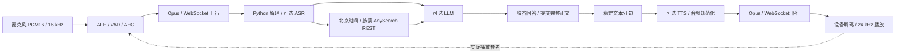

# 总体规划

本文维护架构与阶段目标。完成情况以[当前进度](realtime_voice_progress.md)为准，运行方法见[操作指南](operations.md)。原始方案的接口草案、初始代码基线及逐批交付记录保存在[整理前规划全文](archive/realtime_voice_plan_20261112.md)，不作为现行接口或操作入口。

2026-11-17 结项：用户已确认固定语音链路、字幕、双按钮、D2 插话、重连、多轮、曼波播报和联网查询功能正常。本文保留架构与实施过程；P5.4 的量化时延和长期统计改为未来可选工作，不再作为结项前置条件。AEC 仅有近端主观效果及 D2 功能确认，未扩大为完整声学校准。

## 架构与目标

ESP32-S3 负责采集、前端处理、讲话判断、编码、播放和本地停播；Python 服务负责会话、可替换的 ASR → LLM → TTS 流水线及厂商协议。设备只连接统一服务，云模型选择不要求重新烧录固件。

三层分别提供至少两种接入选项，按实际能力交叉组合。当前本地 `realtime_default` 为豆包流式 ASR 2.0 → DeepSeek SSE → 曼波 GPT-SoVITS HTTP TTS；配置模板保留火山双向流式 TTS。曼波在完整回答提交后按有界短段请求 WAV，首段完成即下发，播放期间只预取下一段，全部段复用同一音频流；上游仍为非流式 WAV，适配器提供分段近似 cue 供翻页，不提供精确逐词时间戳。Qwen 整句 ASR 明确标为兼容模式；统一接口不把它变成流式识别。Seeduplex 等直接生成回答和音频的对话服务如需接入，应另设 conversation backend。

## 服务接口与选择边界

| 层 | 接口责任 | 已实现适配器 |
| --- | --- | --- |
| ASR | 启动、送音频、结束、取消；区分 partial、确定片段、整轮 final | `qwen_batch`、`doubao_streaming` |
| LLM | 异步文本增量、取消与关闭；仅输出可播报回答 | DeepSeek／Qwen 的 `chat_completions` |
| TTS | 追加文本、结束、取消；声明音色、模型和实际音频格式 | `volcengine_bidirectional`、`cosyvoice_bidirectional`、`gpt_sovits`（分段请求 WAV） |

适配器、模型 ID、地域、资源和音色分别管理。配置时校验所选能力；严格流式 profile 不接受 batch ASR。未选择的服务无需补全凭证。适配器已实现不等于任意模型、账号或音色已通过云验证。

配置以[业务模板](../server/config/voice_config.example.json)和[服务端说明](../server/README.md)为准，不在规划中复制 JSON 或启动命令。业务选项优先级为明确选择 → profile → 文件默认；凭证环境变量优先于本地密钥文件。密钥留在服务端，设备和能力查询只得到脱敏选项。

实时路径在 LLM 前补充北京时间；独立日期／时间问题可直接生成答案，时效性问题按规则调用 AnySearch REST，将有界结果仅作为本轮外部资料交给 LLM。检索失败直接播报无法核实，不把错误正文或搜索资料持久写入历史；与原回合共享取消和 120 秒总预算。此路径不依赖 MCP，旧 HTTP 入口保持原契约，配置和验证边界见[联网查询说明](../server/README.md#当前日期与-anysearch-联网查询)。

选择绑定不可变的会话配置。更换组合使用新会话并清除旧上下文；活动回合不静默切服务。立即切换时先取消旧回复并确认停播，再清理旧会话、校验新组合、建立新 epoch。切换失败应明确反馈并允许重新选择。

## 模块与任务责任

| 目录／模块 | 责任 |
| --- | --- |
| `main/main.cpp`、`main/app/` | 入口、初始化、控制器、回合与共享状态 |
| `main/audio/` | I2S、PCM、AFE feed／fetch、自动发言、参考时线、插话、Opus 和播放 |
| `main/network/` | Wi-Fi、WebSocket、音频协议与收发 |
| `main/display/`、`main/fonts/` | 驱动、UI 和静态资源；消费线程安全状态 |
| `server/core/` | 配置、能力注册、会话、流水线和分句 |
| `server/providers/` | 各厂商 ASR／LLM／TTS 协议 |
| `server/transport/`、`server/audio/` | HTTP／WS 契约、PCM 和有状态 Opus |
| `tools/`、`server/tests/` | 开发工具、主机检查与服务端测试 |

采集、AFE、编解码、网络与播放分工运行；任务优先级、绑核和预算由测量决定。音频和网络回调不阻塞云请求；UI 不承担音频处理。状态分别表达连接、采集、回复与播放，允许同时表示播报和监听。

新增固件源需同步 CMake／依赖并核对实际入编；资源按内部 RAM、DMA 和 PSRAM 分开计量。硬件引脚保持麦克风 I2S1 的 GPIO4／5／6、扬声器 I2S0 的 GPIO15／16／17／SD8；已确认双按钮使用 GPIO7／3，按下接 GND。按钮初始化拒绝当前音频和 LCD 占用脚；其他载板复用需核对后再配置。

## 音频与本地前端

| 路径 | 约定 |
| --- | --- |
| 上行 | raw Opus，16 kHz、mono、20 ms；内部 PCM16LE 每帧 320 样本 |
| 下行 | raw Opus，24 kHz、mono、20 ms；内部 PCM16LE 每帧 480 样本 |
| 码率 | 初始目标上行 24 kbps／下行 32 kbps，VBR；实际负载和准确率需实测 |
| PCM 回退 | 仅显式协商且服务允许时启用，不在一个流中静默换编码 |
| AFE | 始终处理 PCM，feed／fetch 块长从 SDK 查询，再重组为 20 ms 帧 |

Opus 编解码器按会话／流保持状态，处理前瞻、尾帧补零及有效样本裁剪；网络载荷不带 WAV／Ogg／WebM 容器。云格式由 Python 适配器转换，不能假定云原始 Opus 可直接透传设备。真实录音的 PCM／Opus 对照用于评估准确率、听感和负载，不能用载荷码率代替总网络带宽。

空闲起音与播放中插话使用独立门控，保留连续样本位置、预录和有界握手缓存。起音确认前不创建云回合；确认后按媒体节奏上传完整预录和讲话。参数及诊断入口集中在操作指南。连续性错误、缓存溢出和握手超时必须明确失败，不通过跳帧或回放旧 PCM 继续。

数字播放参考来自设备解码、音量缩放后实际完成 DMA 的 PCM；覆盖静音、代际和有效性边界。24→16 kHz 有状态重采样并映射到麦克风时线。数字时线健康只是 AEC 前提；当前用户确认近端讲话主观效果及 D2 插话功能正常。若未来需要完整声学结论，可另做受控远端、近端／双讲保真与校准，不影响本次结项。

当前回复先完整生成，再通过有界 `llm.delta` 与 `llm.done` 一次提交正文，之后才开始 TTS 和音频下发。播报开始时回答已可翻阅；首音等待因此包含完整 LLM 生成时间。字幕把 TTS 样本时间映射到这份固定正文的 UTF-8 范围：火山可提供逐词时间戳，曼波使用覆盖整段 PCM 的近似 cue；字幕不再替换或追加可见文字，不可靠的文本规范化差异停止跟随并保留手动阅读。协议、兼容性与容量集中在[字幕扩展](voice_protocol.md#播报字幕扩展)。

字幕复用实际 DMA 完成边界发布的播放样本时钟；LVGL 每页三条完整文本行，页内静止，当前读字跨页时才切换页面。多字词内按字数均分词时长，属于近似逐字定位，不代表上游有逐字时间戳。字幕处理不进入音频或 ISR 回调，不按墙钟定时翻页。键2短按下一页、长按上一页并接管本轮，下一轮恢复自动翻页；元数据缺失、超限或校验失败保留固定回答和手动阅读，不阻断音频。

完整正文解决文字分批出现；时间锚点仍可能成批提供，音频不等待所有时间戳。已知锚点耗尽时保持当前页，晚到后按 DMA 位置追到当前读字所在页。共享上游 reader 的音频背压也可能推迟尚未读取的时间戳；此前接收／排队／发送诊断保留，各层贡献未量化，未来可按需测量。当前不增加音频／字幕协同预缓冲，不能把全文预载等同于时间戳已经提前到齐。

显示采用深海蓝底、浅青白正文和静态声纹识别，保留原 216 px 宽、三行字库与逐页定位。纯色对象只初始化一次；同页样本更新不布局全文、不改正文、不触发屏幕传输，跨页及状态变化才更新，避免装饰动画占用显示带宽。

D2 确认后先封禁旧回复、完成本地停播栅栏，再发送取消并等待身份匹配的 ACK，随后开新轮。连续讲话在交接期间仍有界缓存；新轮不重复执行空闲起音确认。旧文本、音频和完成事件不能恢复被取消回复。未确认取消成功时不开新轮。

参考小智的职责划分、有界队列和生命周期管理；组件版本、20 ms 帧长、调度和检测参数按本项目 SDK、硬件及数据验证。NS／AGC 根据噪声收益及资源决定；WakeNet 唤醒和 MultiNet 有限命令属于后续可选功能。

## 本地模型与部署

ESP-SR 2.6.1／`vadnet1_medium` 属于设备前端，与服务端 ASR 选择独立。当前采用独立 `model` 分区；布局以[分区表](../partitions.csv)为准，模型镜像和生成清单放在构建目录。

模型选择、打包、烧录清单和启动校验必须贯通。应用能编译不代表模型已部署；模型缺失、损坏或 AFE 初始化失败应明确报告。相关任务完全停止后才能释放模型。新增模型需重新核算 Flash／内部 RAM／PSRAM，按需更新模型镜像及固件；服务端 JSON 不能给设备添加未部署的本地模型。

## 协议、取消与故障

唯一现行通信契约是[设备协议 v1](voice_protocol.md)，旧方案中的 `input.commit`／`turn.interrupt` 等草案事件只保存在归档。`segment_final` 与整轮 final 分开，同一问题只生成一次回复；`response.done` 与实际 `playback.done` 分开。

会话 epoch、turn、generation 和 stream 隔离迟到数据；重连、取消或换配置后旧包不能串入新轮。音频队列有界，背压和超时明确报错，不丢 Opus 包后继续。TTS 失败可保留回答文字并标记语音失败；真实空 final、输入停滞、最终超时和连接错误分别记录。

旧 `/ping`、`/audio` 的 Qwen → DeepSeek 两行文字契约继续兼容。新实时选择不改变旧 HTTP 的格式或行为。日志输出脱敏标识、耗时和固定错误分类；运行数据置于忽略的 `server/data/`，默认不逐帧落盘对话录音。

## 分阶段实施与验收

| 阶段 | 交付目标 |
| --- | --- |
| P1 | 服务接口、能力登记、配置和选择校验，保持旧入口 |
| P2 | 实时服务端、三层适配器、双向 Opus、取消及 PC 云联调 |
| P3 | 设备录放、WS、文字界面、有界队列与手动取消 |
| P4.1 | AFE／VAD、模型部署和内存共存 |
| P4.2 | 预录、自动起止、一次提交、慢握手及半双工恢复 |
| P4.3 | 播放参考、时线、AEC、D1 观察和 D2 插话交接 |
| P5 | 单一链路的双按钮独立操作和自动恢复；量化时延与长期资源统计为可选后续 |

每阶段分别记录代码、主机验证、目标构建和硬件结果。用户决定不继续的专项保留为可选后续；功能实测通过不扩大为完整声学或长期统计验收。历史记录中的未执行项不重新成为本次结项条件，原修复文档的 D3／D4／D5 文件名也不是新增的强制阶段。

## P5 实施顺序

2026-11-13 按用户最新方向收敛：当前只使用一条语音链路，不再推进组合查看或独立模型选择；优先让设备脱离串口完成日常交互和故障恢复。P5.1 已实现的公开组合解析与 epoch 快照保留为内部诊断，屏幕摘要与 `v` 详情移除。“独立操作”仍使用现有网络语音服务，不表示已实现本地 ASR／LLM。

### 当前交付与边界

| 批次 | 用户能得到什么 | 当前边界 |
| --- | --- | --- |
| P5.1 状态与固定链路 | 完整回答先提交再播报；三行正文按播报自动翻页；静态声纹与分层阅读 UI；保留手动接管 | 用户已确认字幕与日常交互正常；精确声画同步未量化 |
| P5.2 双按钮操作 | GPIO7／3 外接低有效按钮；键1暂停／恢复／取消，长按重试；键2前后翻页；就绪后自动监听与 D2 | 用户已确认目标板功能正常 |
| P5.3 自动恢复 | Wi-Fi 与会话有界重试；恢复此前模式；多次失败提示重启；新会话不复活旧轮 | 用户已确认重连功能正常；长期资源趋势未统计 |
| P5.4 时延与稳定性 | 原计划记录逐轮阶段基线和持续运行结果 | 量化方案没有执行证据，转为可选后续，不影响结项 |

原 P5.2 的主机管理页、三层独立选择、运行时切换和持久化均暂缓，只有用户再次需要时再设计；当前不会新增管理网页、选择菜单或服务端控制协议。服务端既有配置能力保留，设备仍显式发送 `CONFIG_VOICE_SERVER_PROFILE`。服务启动时三层 CLI 覆盖不会自动替换该显式 profile。

### 双按钮和自动化原则

- 正常操作无需 UART0 输入，调试命令默认关闭但保留编译选项，日志独立可用。按钮驱动位于 `main/app/local_buttons.*`，手势状态机位于同目录。参考 STM32 示例，复用 `esp_timer` 任务每 10 ms 独立扫描；启动时创建一个定时器，回调无动态分配，通过固定 16 项 FIFO 向主循环交付，主循环约每 20 ms 消费并检查 UI 版本。LVGL 显示和动画计时器均设为 20 ms，ST7789 使用 32 行双缓冲及 SPI 完成栅栏；目标 50 Hz 只是调度周期，实际帧率待设备测量。取 LVGL 锁最多等待 10 ms，失败保留翻页意图再试。
- 用户确认键1 GPIO7、键2 GPIO3，按下接 GND；启用内部上拉、30 ms 去抖和 1 秒长按。上电按住先释放，长短按互斥、同时按不触发；GPIO3 为绑带脚，上电／复位时松开。接法和操作表只维护在[操作指南](operations.md#双按钮与独立操作)。
- 会话与 AFE 就绪后默认自动监听，在当前编译配置和健康 AEC 下自动启用 D2；暂停后重连不擅自重新开启。按钮仅向既有控制任务提交语义动作，不在采集、音频回调或 GPIO 路径调用网络／停播。
- 键1忙时取消本轮，保留下一轮监听；新轮等既有取消流程完成后再开始。已排队本地命令在自动开轮前处理，准备超时停用监听后一次按键即可恢复。长按重试与自动恢复由同一会话控制流程串行清理，不重传旧 PCM，不恢复旧声音。
- Wi-Fi 仍最多 5 次自动重试，并为单周期增加 60 秒上限；会话重试采用 1／2／4／8／15 秒退避、每次 20 秒握手上限，稳定就绪 30 秒才重置预算。耗尽后停止并提示重启，用户长按键1重新尝试；硬故障保留明确恢复提示。
- 不改变当前 AEC／VAD 参数、音频任务优先级、核分配、QIO／80 MHz、模型、服务端地址或云组合。普通正文、随播字幕与手动阅读统一为每页三完整行，自动翻页只由有效播放位置驱动；组合快照继续遵循有界白名单、未知值和当前 epoch 失效规则。

### 历史功能验证顺序

- 原定验证顺序覆盖上电自动就绪、完整正文与三行字幕、手动翻页、按钮短长按、暂停与取消、D2、服务／Wi-Fi 中断恢复和 160 ms 起音过滤。用户现已确认这些功能实测正常；不要求为结项重复执行，也不据此声称每个历史诊断子场景均有独立日志。

主机检查覆盖真实按钮电平与应用路由、去抖／长短按／同时按／时钟回绕、生产 UI 几何与分页、会话有界恢复和旧事件隔离。主机桩不证明实际 GPIO 电气、LVGL 字体像素、双核并发或网络时延；目标构建、烧录与硬件结果分别登记。

### P5.4 可选量化方案

以下保留原测量设计，没有执行证据，不作为当前结项要求。用户感知网络好时回答延迟通常在 1 秒内、差时可能 2–3 秒；计时起点、样本量和 P95 未定义，不能将其写成性能承诺或唯一归因于网络。

| 范围 | 要记录的阶段 |
| --- | --- |
| 服务端同一时钟 | 输入提交到 ASR final、final 到首个可播回答增量、首段提交 TTS 到首音频、队列与发送等待 |
| 设备同一时钟 | 结束发言到收到结果／首个内容写入播放、D2 确认到软件停播栅栏／取消 ACK／新轮首包 |
| 实际听感 | 首字尾音、开头卡顿、插话停声、旧声音不恢复；软件 DMA 提交不能代替声学测量 |

每轮按 epoch／turn／generation、组合、交互模式和成功／空结果／取消／失败分类。设备与主机绝对时间戳不直接相减；先记录基线，再按相同场景比较中位数／P95 和最大值，样本不足时报告单次值及数量。结果放在已有运行数据目录，不增加逐帧打印或无界样本。

若未来需要量化稳定性，可采用原设计的 20 轮混合交互、3 次重连及约 2 小时待机／对话运行，记录内部 RAM／DMA／PSRAM、最大连续块、任务栈、分配失败和队列趋势。这组方案目前无执行证据，不标记完成，也不影响结项。

本次 P5 按已确认的固定链路对话、D2、双按钮、状态提示和重连功能正常结项。量化时延基线、持续资源统计、独立模型选择、完整声学校准与唤醒／离线命令均列为可选后续，未执行的内容保持未执行状态。
